# Lehmfront – Spielplan, Version 2

Taktisches Grabenkriegsspiel in 2D für den Browser. Du übernimmst einen Frontabschnitt in einem fiktiven Krieg, gräbst Stellungen, baust die Etappe hinter der Front aus, versorgst deine Leute über Loren und Laufgräben und entscheidest, wann angegriffen wird und wann nicht. Rundenbasiert mit gleichzeitiger Befehlsausführung (WEGO), zwei Zeitmaßstäben (Stellungsrunde und Gefechtsrunde), Singleplayer-Kampagne mit Lore, Endlosmodus, Hotseat und asynchronen Online-Gefechten über Supabase.

Überarbeitung von Idee 31. Version 2 arbeitet die Kritik an Version 1 ein.

Stand 2.1: Tageszeit als Stilwechsel (Abschnitt 7.7), Stilvarianten (7.8) und das UI-Mockup mit Bildern und Code (Anhang A). Die Bilder liegen neben dieser Datei unter `bilder/`, der Mockup-Code unter `ui/`.

## Was sich gegenüber Version 1 geändert hat

| Thema | Version 1 | Version 2 |
|---|---|---|
| Umfang | 34 Mechaniken, alles in einem Wurf | 12 Kernmechaniken für Release 1.0, Rest in nummerierten Ausbaustufen |
| Zeitskala | 1 Runde = 1 Stunde | Stellungsrunde (12 Stunden) und Gefechtsrunde (5 Minuten), dieselbe Engine |
| Etappe | Eigenes Raster, dritte Ebene | Hinteres Drittel der Gefechtskarte, physisch an die Front angebunden |
| Kampagnenrahmen | Ansehen beim Stab | Ansehen beim Stab gegen Vertrauen der Truppe, Enden werden daraus abgeleitet |
| Fraktionen | Nur Lore | Mechanisch asymmetrisch, beide spielbar |
| Gräben | Deckung in beide Richtungen | Feuerrichtung, eroberte Gräben müssen umgebaut werden |
| Unterstände | Schutz vor Artillerie | Wettlauf zum Grabenrand als Kern des Sturmangriffs |
| Artillerie | Reaktiv | Feuerplan vorab, Umlenken nur mit Beobachter und Leitung |
| Versorgung | Vier Ressourcenzähler | Lorenkapazität als eine Entscheidung, Verwundete fahren zurück |
| Forschung | Baum mit 48 Knoten | Etwa 20 Erfahrungsberichte, freigeschaltet durch Tun |
| Stollen | Eigener Kartenlayer | Gestrichelte Linie auf derselben Karte, Horchposten mit Radius |
| Gas | Gasmasken ohne Gas | Gas in Akt 3 mit Windrichtung, Gasmasken erst dann |
| Funk und Täuschung | Akt 3 | Nur Multiplayer |
| Bestätigung | Zwei Tipps pro Befehl | Ein Commit bei „Runde ausführen" mit Zusammenfassung, Undo für Befehle |
| Rundenbericht | Ereignisse | Ereignisse mit Begründung, von Anfang an im Protokoll |
| Look | Lagekarte plus lebendige Draufsicht beim Zoomen | Durchgehend Lagekarte, lebendige Ebene später |
| Figuren | Erzählfiguren | An Spielsysteme gekoppelt, Namenssprache pro Fraktion |
| Fundstücke | 60 handgeschrieben | 24 handgeschrieben plus generierte Feldpost aus dem Ereignisprotokoll |
| Modi | Kampagne, Gefecht frei, Tageslage, Online | Dazu Endlosmodus, Hotseat, Koop, Replay-Link, Sandbox, Puzzle-Lagen, Editor |
| Online-Zustand | `matches.state` für beide lesbar | Voller Zustand nur für die Edge Function, gefilterte Sicht pro Spieler |
| Meilensteine | Online zuletzt | Online-Durchstich direkt nach dem Prototyp |
| Tageszeit | Nacht dunkelt die Karte ab | Tag ist Stil 01, Nacht ist Stil 04, der Übergang läuft im Phasenfilm beim Rundenwechsel; Gedrucktes immer in Stil 03 |

---

## 1. Pitch

Ein Frontabschnitt von wenigen Kilometern, über Monate umkämpft. Jeder Meter Graben ist erkämpft, jede Granate muss per Lore nach vorne, jeder Verwundete auf derselben Lore zurück. Du bist nicht der Held im Schützengraben, sondern die Abschnittskommandantin: Du planst, gräbst, versorgst und entscheidest, wann angegriffen wird und wann nicht. Der Stab will Gelände, deine Leute wollen leben. Beides zugleich bekommst du selten.

**Was es besonders macht**
- **Gleichzeitige Züge (WEGO)**: Beide Seiten geben Befehle, dann läuft die Runde für alle ab. Du planst gegen das, was der Gegner vorhaben könnte.
- **Zwei Zeitmaßstäbe**: Stellungsrunden von zwölf Stunden für Graben, Bauen, Ablösen und Versorgen. Gefechtsrunden von fünf Minuten, sobald jemand angreift. Angriffe sind seltene, geplante Set-Pieces.
- **Graben ist Gelände**: Gräben haben eine Feuerrichtung, Krater werden zu Schlamm, Stollen und Sappen verändern die Karte dauerhaft.
- **Wettlauf zum Grabenrand**: Unter Beschuss sitzt der Verteidiger im Unterstand. Kommt dein Sturm an, bevor er wieder oben ist, oder läuft er ins MG?
- **Versorgung als Kapazität**: Die Feldbahn fährt eine feste Zahl Loren pro Runde. Munition, Verpflegung oder Material nach vorne, Verwundete zurück. Du entscheidest, was fährt.
- **Stab gegen Truppe**: Zwei sichtbare Werte, Ansehen beim Stab und Vertrauen der Truppe. Jede Mission bewegt beide, das Ende der Kampagne ergibt sich daraus.
- **Ernster Ton**: Briefe, Tagebuch, Gefallenenliste mit Namen. Kein Heldenepos.

### 1.1 Umfang und Veröffentlichung

| Stufe | Inhalt |
|---|---|
| **Release 1.0** | 12 Kernmechaniken, Akt 1 (6 Missionen, Tutorial integriert), Gefecht frei mit beiden Fraktionen (4 Karten plus Zufallskarten), Tageslage mit nachgerechneter Bestenliste, Hotseat, Cloud-Spielstand |
| **1.1** | Asynchrone Online-Gefechte gegen Freunde, Replay-Link, Endlosmodus „Frontabschnitt", Wochenlage |
| **1.2** | Akt 2 mit Sappen, Stollen, Stoßtrupps, Offizieren, Doktrinen |
| **1.3** | Akt 3 mit Feuerwalze im großen Stil, Gas, Flugzeugen, Feldgeschütz |
| **1.4** | Akt 4 mit Panzerwagen, großer Mine, Verweigerung, vier Enden |
| **1.5** | Koop gegen KI, Missionseditor, Stellungsbau-Sandbox, Puzzle-Lagen |

Alles, was nicht in 1.0 steht, wird so gebaut, dass es in Daten und Regeln später hinzukommt, nicht in der Architektur.

---

## 2. Welt und Lore

### 2.1 Setting

Eine fiktive Welt, technisch etwa auf dem Stand um 1915, ohne reale Länder, Personen oder Symbole.

Der **Kontinent Veldar** ist seit Jahrzehnten durch den Grenzfluss **Asse** geteilt. Im Westen liegt die **Republik Kaldern**, ein Bund aus Handelsstädten mit starker Industrie, aber kleiner Bevölkerung und kleinem Heer. Im Osten das **Haus Morrow**, ein altes Königreich mit großem Heer, aber rückständigen Fabriken. Als ein Grenzstreit um die Kohlegruben im **Lehmgau** eskaliert, erwarten beide Seiten einen kurzen Sommerfeldzug. Nach drei Wochen graben sich beide Armeen ein. Die Front erstarrt im Lehm.

Weil Kaldern wenig Menschen hat, kommen seine Offiziere aus der Technikerlaufbahn und Frauen dienen selbstverständlich in allen Rängen. Morrow stellt Masse, hält an Adel und Tradition fest und lässt Frauen nicht an die Front. Beides steht nie als Erklärung im Spiel, sondern zeigt sich in Briefen, Namen und Befehlen.

### 2.2 Fraktionen

Beide Seiten sind spielbar (Kampagne: Kaldern; Gefecht frei, Endlos, Multiplayer: beide).

| | Republik Kaldern | Haus Morrow |
|---|---|---|
| Artillerie | Mehr Rohre, mehr Munition, präziser | Weniger Rohre, größere Streuung |
| Ersatz | Kommt langsam, neue Gruppen sind klein | Kommt schnell, Gruppen sind größer |
| Verluste | Wiegen schwer auf Vertrauen und Ansehen | Wiegen leichter auf Ansehen, gleich auf Vertrauen |
| Material | Beton und Faschinen früh verfügbar | Holz und Erde, Beton erst spät |
| Moral | Bricht schneller ein, erholt sich schneller | Zäher, erholt sich langsamer |
| Besondere Einheit | Pioniere graben schneller | Stoßtrupps früher verfügbar |

### 2.3 Namen

Pro Fraktion eine Namenssprache, damit niemand auf ein reales Land zeigt und generierte Soldaten klingen, als gehörten sie zusammen.

| | Vornamen | Nachnamen |
|---|---|---|
| Kaldern (niederländisch und niederdeutsch angehaucht) | Ilse, Otto, Jost, Hinrich, Wiebke, Arend, Geske, Tjark, Maren, Dirk | Brandt, Harms, Vell, Boysen, Tiedemann, de Groot, Wessel, Lohmann, Fedders, Albers |
| Morrow (baltisch und slawisch angehaucht) | Teodor, Arvo, Jurgis, Dainis, Ruta, Milan, Ignas, Ludmila, Kazimir, Vesna | Lask, Kalnis, Ozols, Vaitkus, Mirek, Dravin, Berzin, Sorek, Lenart, Vilks |

Die Listen liegen in `data/names.json` und werden für Gruppenführer, Briefe und die Gefallenenliste genutzt.

### 2.4 Hauptfiguren

Jede Figur hängt an einem Spielsystem, sonst bleibt sie Kulisse.

| Figur | Rolle | Im Spiel |
|---|---|---|
| **Major Ilse Brandt** | Du. Frisch beförderte Abschnittskommandantin, Ingenieurin, eigentlich für Brückenbau ausgebildet | Tagebuch, Entscheidungen, die beiden Werte Ansehen und Vertrauen |
| **Feldwebel Otto Harms** | Erfahrener Unteroffizier, trocken, pragmatisch | Gruppen in seiner Nähe erholen Moral schneller. Kann einmal pro Mission eine Verweigerung abwenden. Kann fallen |
| **Dr. Mira Selin** | Ärztin im Feldlazarett | Steht für die Sanitätskette. Ihre Briefe berichten, welche Verwundeten liegen blieben, weil keine Lore zurückfuhr. Konkurriert mit Vell um Loren |
| **Leutnant Jost Vell** | Ehrgeiziger junger Offizier, will Orden | Ab Akt 2 spielbarer Zugführer mit Bonus auf Sturm. Entscheidung in Akt 2 hat mechanisches Gewicht, weil er fallen kann |
| **Oberst van Aurach** | Dein Vorgesetzter im Stab, weit weg von der Front | Quelle der Stabsbefehle, bestimmt Nachschub über Ansehen |
| **Hauptmann Teodor Lask** | Gegnerischer Kommandant von Haus Morrow | Persönlichkeit der KI. Seine Doktrin wechselt pro Akt, abgefangene Briefe kündigen sie an. Bietet Waffenruhen an |

### 2.5 Erzählweise

- **Briefe**: Zwischen den Missionen liest du Briefe deiner Soldaten nach Hause. 24 handgeschriebene Briefe tragen die Hauptgeschichte. Dazu **generierte Feldpost**: Vorlagen in `data/letters/templates.json` mit Platzhaltern für Gruppenführer, Heimatort und ein echtes Ereignis aus dem Protokoll der letzten Mission, in drei Tonlagen (zuversichtlich, erschöpft, verbittert) je nach Moral und Vertrauen
- **Tagebuch**: Brandts Eintrag nach jeder Mission, abhängig vom Verlauf
- **Gefallenenliste**: Nach jeder Mission mit Name, Gruppe, Runde und Ursache. Gesammelt im „Buch des Abschnitts" im Tagebuch
- **Stabsbefehle**: Telegramme mit Stempel, auch an den Verteidiger („Verlorenen Graben bis morgen früh zurücknehmen")
- **Entscheidungen**: An festen Punkten wählst du (Befehl befolgen, umdeuten, verweigern). Jede Wahl bewegt Ansehen und Vertrauen, statt direkt ein Ende zu schalten
- **Fundstücke**: 24 Fundstücke (Fotos, Feldpostkarten, Karten) für Nebengeschichten

### 2.6 Die zwei Achsen: Ansehen und Vertrauen

Beide Werte laufen von 0 bis 100, sind immer sichtbar und reagieren auf jede Mission.

| | Ansehen beim Stab | Vertrauen der Truppe |
|---|---|---|
| Steigt durch | Stabsbefehl erfüllt, Gelände gewonnen, Gefangene eingebracht | Rechtzeitige Ablösung, warme Mahlzeiten, Post, geborgene Verwundete, Waffenruhe angenommen, Angriffe mit geringen Verlusten |
| Sinkt durch | Befehl verweigert, Gelände verloren, Waffenruhe angenommen | Hohe Verluste, Gruppen zu lange vorn, Sturm trotz Vorschau-Warnung (erwartete Verluste über 50 Prozent), liegen gelassene Verwundete |
| Wirkt auf | Nachschubmenge pro Stellungsrunde, Ersatz, Zugang zu Batterien und Erfahrungsberichten | Moralerholung, Grabgeschwindigkeit, Bereitschaft zum Sturm |
| Unter 25 | Stab droht mit Ablösung | Gruppen können Sturmbefehle verweigern (Akt 4) |
| Unter 10 | Brandt wird abgelöst, Kampagne endet vorzeitig | Meuterei, Mission verloren |

**Enden** (Akt 4, aus beiden Werten abgeleitet):

| Ansehen | Vertrauen | Ende |
|---|---|---|
| hoch | niedrig | **Durchbruch um jeden Preis**: Der Abschnitt bricht durch, der Preis steht in der Gefallenenliste |
| niedrig | hoch | **Waffenstillstand im Abschnitt**: Brandt und Lask einigen sich lokal, Brandt wird danach abgelöst |
| niedrig | niedrig | **Abgelöst**: Brandt erlebt das Ende als Beobachterin |
| hoch | hoch | **Der Abschnitt hält**: Der Krieg endet anderswo, der Abschnitt bleibt stehen. Schwer zu erreichen |

---

## 3. Spielaufbau

### 3.1 Die zwei Ebenen

```
Feldzugskarte (zwischen Missionen: Stab, Erfahrungsberichte, Doktrin, Ersatz, Briefe)
   └── Gefecht (eine Karte mit Etappe, Stellung und Niemandsland, Stellungs- und Gefechtsrunden)
```

Die Etappe ist keine eigene Ebene mehr, sondern das hintere Drittel der Gefechtskarte (Abschnitt 6).

### 3.2 Die Karte

- **Quadratraster**, ein Feld etwa 10 Meter, Karten von 60 x 40 bis 120 x 60 Feldern
- **Drei Zonen** von hinten nach vorn: Etappe (Gebäude, Gleise, Depot), Stellung (Gräben, Unterstände, Batterien), Niemandsland (Draht, Krater, Schlamm). Dahinter spiegelbildlich der Gegner
- **Höhe** in vier Stufen pro Feld. Höhere Felder sehen weiter und über niedrigere hinweg, Wasser läuft nach unten, Gräben in Senken versumpfen zuerst
- **Boden**: Lehm, Kreide, Fels, Sumpf, Wald, Dorf. Bestimmt Grabgeschwindigkeit, Deckung und Schlammanfälligkeit
- **Feuerrichtung**: Jedes Grabenfeld hat eine Richtung, in die der Schützenauftritt zeigt

### 3.3 Zwei Rundenarten

| | Stellungsrunde | Gefechtsrunde |
|---|---|---|
| Spielzeit | 12 Stunden (Tag oder Nacht) | 5 Minuten |
| Wann | Standard | Sobald eine Seite einen Angriff angesetzt hat |
| Befehle | Graben, Bauen, Umbauen, Draht, Ablösen, Lorenplan, Feuerplan, Störfeuer, Stollen, Stoßtrupp (nachts), Beobachten | Bewegen, Feuern, Halten, Deckung (Unterstand), Sturm, Feuer verlegen, Feuer einstellen |
| Ende | Nach Ausführung | Angriff steckt (alle Sturmgruppen halten oder sind ausgefallen), Ziel genommen, oder nach 12 Gefechtsrunden (eine Stunde) |
| Mission | 10 bis 20 Stellungsrunden, ein bis drei Angriffe | |

Beide Rundenarten nutzen dieselbe Auflösung in `resolve.js`, nur mit anderen Phasen und Dauern (Abschnitt 10.6).

### 3.4 Ablauf einer Runde

1. **Lagebild**: Aufklärung zeigt, was du sehen kannst. Bedrohungs-Overlay zeigt bekannte MG-Kegel, Artilleriereichweiten und zuletzt gesehene Bewegung
2. **Befehle**: Für jede Gruppe oder jeden Zug. Standardbefehl ist „Halten", ohne Klick. Jeder Befehl zeigt vorher Trefferchance, Deckung, erwartete Verluste oder Dauer
3. **Runde ausführen**: Ein einziger Commit mit Zusammenfassung („3 Gruppen stürmen, Batterie 2 feuert Walze, Munition reicht 2 Runden, Gruppe 5 ohne Befehl"). Ist ein Sturm geplant, muss der Knopf gehalten werden
4. **Ausführung**: Beide Befehlslisten laufen in Phasen ab, als kurzer Film mit „Weiter" pro Phase
5. **Bericht**: Telegramm mit Verlusten, Gewinnen, Ereignissen und jeweils einer Begründung. Klick auf eine Zeile springt zur Stelle auf der Karte

---

## 4. Spielmechaniken

### 4.1 Kern (Release 1.0)

| Nr. | Mechanik | Kurzbeschreibung |
|---|---|---|
| 1 | **Graben ausheben** | Gruppen graben Feld für Feld in Stellungsrunden. Fortschritt hängt von Boden, Werkzeug, Wetter, Erschöpfung und Vertrauen ab. Pioniere doppelt so schnell |
| 2 | **Grabenstufen und Feuerrichtung** | Schützenloch, Schützengraben, ausgebauter Graben mit Faschinen, betonierter Graben. Jede Stufe mehr Deckung. Der Schützenauftritt zeigt in eine Richtung. Ein eroberter Graben gibt nur halbe Deckung, bis er mit dem Befehl „Umbauen" gedreht ist (eine Stellungsrunde je drei Felder, Pioniere schneller). Dadurch hat der Gegenstoß eine Chance |
| 3 | **Zickzack und Längsfeuer** | Gerade Grabenabschnitte können von einem Ende aus bestrichen werden, Deckung sinkt auf 30 Prozent. Beim Zeichnen warnt das Spiel und bietet „Traversen einfügen" an |
| 4 | **Stacheldraht und Unterstände** | Draht verlangsamt Angreifer und wird durch Artillerie, Drahtscheren oder Sprengrohre zerstört. Unterstände schützen vor Artillerie: Gruppen gehen unter Beschuss automatisch hinein, sind dort unerreichbar, feuern aber nicht. Herauskommen dauert eine Gefechtsrunde. Das ist der **Wettlauf zum Grabenrand**: Hört die Feuerwalze zu früh auf, steht der Verteidiger am MG, bevor der Sturm ankommt. Läuft sie zu dicht, trifft sie die eigenen Leute |
| 5 | **Gelände: Deckung, Sicht, Höhe** | Treffer hängen von Deckung, Entfernung, Sicht und Erfahrung ab. Sichtlinien werden beim Zeigen auf der Karte gezeichnet. Höhe sieht über niedrigere Felder hinweg und gibt Beobachtern Reichweite |
| 6 | **Wetter, Schlamm, Krater** | Regen füllt Gräben, zuerst in Senken. Schlamm senkt Bewegung, Grabgeschwindigkeit und Moral. Beschuss hinterlässt Krater, die Deckung geben, aber das Feld zu Schlamm machen. Wer am meisten schießt, kann am schlechtesten nachrücken. Entwässerung (Pumpe, Lattenrost) ist eine Grabenverbesserung |
| 7 | **Unterdrückung und MG-Sektoren** | Beschossene Gruppen werden niedergehalten und handeln schlechter, auch ohne Verluste. MG-Trupps legen Feuerkegel auf die Karte. Unterdrückung pro Schuss hängt von der Waffe ab |
| 8 | **Artillerie nach Feuerplan** | Batterien stehen in der Etappe. In der Stellungsrunde legst du Feuerpläne an: Vorbereitungsfeuer, Sperrfeuer, Feuerwalze (Startlinie, Richtung, Schritt pro Gefechtsrunde, Dauer, Batterien, Munitionskosten). In der Gefechtsrunde kann nur ein Beobachter mit intakter Leitung „Feuer verlegen" oder „Feuer einstellen", mit einer Runde Verzögerung per Telefon, zwei per Melder. Durchtrennte Leitungen bedeuten blinde Artillerie. Gegenbatteriefeuer gegen aufgeklärte Batterien |
| 9 | **Sturm, Nahkampf, Gegenstoß** | Gruppen verlassen den Graben, überqueren das Niemandsland, brechen ein. Nahkampf im Graben wird Feld für Feld ausgetragen. Der Verteidiger bekommt Stabsbefehle zum Gegenstoß, damit sich niemand einigelt |
| 10 | **Versorgung als Lorenkapazität** | Munition, Verpflegung und Material liegen im Depot. Die Feldbahn fährt pro Stellungsrunde eine feste Zahl Loren (Ausbau erhöht sie). Du stellst den Lorenplan: was fährt nach vorne in welchen Grabenabschnitt, Verwundete fahren mit denselben Loren zurück. Abgeschnittene Abschnitte zehren vom Vorrat, dann sinkt Moral. Laufgräben verbinden Gleisende und Front. Die **Sanitätskette** (Verbandsplatz, Lazarett) hängt daran: Wer zurückkommt, kehrt später erfahren zurück |
| 11 | **Etappe auf der Karte** | Gebäude auf Feldern im hinteren Drittel, Ertragsvorschau mit Nachbarboni, beschießbar und aufklärbar (Abschnitt 6) |
| 12 | **Moral, Erschöpfung, Ablösung, Ersatz** | Moral pro Gruppe und für den Abschnitt. Gruppen erschöpfen vorn und erholen sich im Ruhelager. Du rotierst zwischen Front, Reserve und Ruhe. Ersatz ist grün: Eine zerschlagene Gruppe auffüllen senkt ihre Erfahrung, unterbesetzt lassen hält sie |

**Kampagnenrahmen** (in 1.0, aber keine Gefechtsmechanik): Stabsbefehle, Ansehen, Vertrauen (Abschnitt 2.6) und Erfahrungsberichte (Abschnitt 4.3).

### 4.2 Ausbau (nach 1.0)

| Nr. | Mechanik | Ab | Kurzbeschreibung |
|---|---|---|---|
| 13 | **Sappen** | Akt 2 | Vorgetriebene Annäherungsgräben, langsam, aber gedeckt |
| 14 | **Stollen und Horchposten** | Akt 2 | Gestrichelte Linie auf derselben Karte, Fortschritt pro Stellungsrunde, Sprengung am Ziel. Horchposten entdecken Stollen im Radius mit Wurf pro Runde. Kein eigener Kartenlayer |
| 15 | **Stoßtrupps, Nacht, Leuchtkugeln** | Akt 2 | Nachts sieht niemand weit, Leuchtkugeln erhellen kurz einen Kreis und verraten Bewegung. Stoßtrupps nehmen Gefangene und klären auf |
| 16 | **Offiziere** | Akt 2 | Zugführer mit Fähigkeiten für Gruppen in ihrer Nähe. Können fallen und sind dann weg. Vell ist einer |
| 17 | **Veteranen-Eigenschaften** | Akt 2 | Nachtkämpfer, Gräber, Scharfschützen, unerschütterlich, wachsam (kommt schneller aus dem Unterstand) |
| 18 | **Doktrinen** | Akt 2 | Pro Akt eine von drei (Tiefe Verteidigung, Infiltration, Materialschlacht) |
| 19 | **Erweiterte Aufklärung** | Akt 2 bis 3 | Fesselballon, Flugzeug, Gefangenenbefragung, Schallmessung für Gegenbatteriefeuer |
| 20 | **Gas** | Akt 3 | Gasgranaten erzeugen eine Wolke, die mit dem Wind zieht. Windvorhersage pro Stellungsrunde mit Unsicherheit, Windwechsel ist ein echtes WEGO-Risiko. Mit Gasmaske Unterdrückung, ohne schwere Verluste. Kostet beide Seiten Moral, Briefe greifen es auf. Gasmasken erst ab hier |
| 21 | **Waffenruhe** | Akt 3 | Lask bietet eine Waffenruhe zum Bergen an. Annehmen hebt Vertrauen, senkt Ansehen, kann ausgenutzt werden |
| 22 | **Feldgeschütz, Flammenwerfer, Flugzeug** | Akt 3 | Direktfeuer nach vorne gezogen, Unterstände säubern, Karte aufdecken |
| 23 | **Verweigerung** | Akt 4 | Bei Vertrauen unter 25 verweigert eine Gruppe einen Sturm mit erwarteten Verlusten über 50 Prozent. Harms kann einmal pro Mission vermitteln |
| 24 | **Panzerwagen und große Mine** | Akt 4 | Prototyp überquert Draht und Gräben, bleibt oft liegen. Eine gewaltige Mine unter der feindlichen Linie |
| 25 | **Funk und Täuschung** | Multiplayer | Funksprüche abhören, falsche Befehle senden, um Reserven zu binden. Gegen KI nicht erlebbar, deshalb nur gegen Menschen |

### 4.3 Erfahrungsberichte statt Forschungsbaum

Technik wird freigeschaltet, indem die Truppe etwas tut. Das passt zu einer Armee, die den Stellungskrieg im Krieg lernt, und braucht kein Baum-UI. Etwa 20 Berichte, Beispiele:

| Bericht | Auslöser | Wirkung |
|---|---|---|
| Faschinenbau | 200 Felder Graben ausgehoben | Grabenstufe 3 verfügbar |
| Traversen | Eine Gruppe durch Längsfeuer verloren | „Traversen einfügen" kostet keine Extrazeit |
| Lattenroste | Erste Stellungsrunde mit Schlamm in eigenen Gräben | Entwässerung als Grabenverbesserung |
| Tiefer Unterstand | Ein Unterstand hat ein Vorbereitungsfeuer überstanden | Stollenunterstand baubar |
| Drahtscheren | Ein Sturm ist am Draht gescheitert | Schützengruppen schneiden Draht |
| Feuerwalze | Drei Vorbereitungsfeuer geplant | Feuerwalze als Feuerplan |
| Doppelleitung | Eine Leitung wurde im Gefecht durchtrennt | Leitungen können doppelt verlegt werden |
| Stahlhelme | 50 Verwundete durch Artillerie | Verluste durch Splitter sinken |
| Leichtes MG | Ein MG-Trupp hat einen Sturm abgewehrt | Schützengruppen können ein leichtes MG tragen |
| Grabenkeulen | Drei Nahkämpfe gewonnen | Nahkampfbonus |
| Sanitätsloren | 20 Verwundete per Lore zurückgefahren | Lore nimmt doppelt so viele Verwundete |
| Feldbahn ausbauen | Depot zweimal leer gelaufen | Zweite Gleisstrecke |

Berichte liegen in `js/config.js`, Auslöser werden aus dem Ereignisprotokoll gezählt.

---

## 5. Einheiten

Du führst Gruppen (8 bis 12 Mann) mit Stärke, Erfahrung (0 bis 4), Erschöpfung, Moral und einem benannten Gruppenführer mit Heimatort. Fällt der Gruppenführer, steht er in der Gefallenenliste und die Gruppe verliert kurzzeitig Moral.

| Einheit | Rolle | Verfügbar |
|---|---|---|
| Schützengruppe | Standard, gräbt, kämpft, trägt | Start |
| Pioniere | Graben doppelt so schnell, Draht, Umbauen, Sprengungen | Start (Kaldern billiger) |
| MG-Trupp | Feuersektor, Unterdrückung | Start |
| Sanitäter | Bergen, Erstversorgung, Verwundete zur Lore | Start |
| Melder | Stellt Verbindung her, wenn die Leitung ausfällt | Start |
| Beobachter | Lenkt Artillerie, sieht weit, braucht Höhe oder Turm | Start |
| Grabenmörser | Kurze Reichweite, steile Flugbahn, trifft in Gräben | Akt 1, Mission 4 |
| Stoßtrupp | Nachtangriff, Infiltration, Gefangene | Akt 2 (Morrow früher) |
| Scharfschützen | Beobachter und Offiziere ausschalten | Akt 2 |
| Horchposten | Erkennt feindliche Stollen | Akt 2 |
| Flammenwerfer-Trupp | Säubert Unterstände, sehr gefährdet | Akt 3 |
| Feldgeschütz | Direktfeuer, kann nach vorne gezogen werden | Akt 3 |
| Aufklärungsflugzeug | Deckt Karte auf, lenkt Artillerie | Akt 3 |
| Panzerwagen (Prototyp) | Überquert Draht und Gräben, oft liegengeblieben | Akt 4 |

Batterien (Feldhaubitzen, schwere Haubitzen) sind keine Gruppen, sondern Etappengebäude mit Munition, Reichweite und Streuung.

---

## 6. Etappe auf der Karte

Das hintere Drittel der Karte ist deine Etappe. Du tippst ein Feld an, siehst die Bauoptionen und vor dem Bauen, was jedes Gebäude pro Stellungsrunde bringt, inklusive Nachbarboni. Gebäude kosten Material und Bauzeit in Stellungsrunden, können vom Gegner aufgeklärt und beschossen werden und müssen dann repariert werden.

Innerhalb eines Akts bleibt der Abschnitt derselbe, die Etappe bleibt stehen. Beim Aktwechsel übernimmst du einen neuen Abschnitt mit dem Grundausbau, den die Mission vorgibt. Männer, Erfahrung, Erfahrungsberichte, Ansehen und Vertrauen bleiben immer.

| Gebäude | Wirkung | Nachbarbonus | Ab |
|---|---|---|---|
| Depot | Lager für Munition, Verpflegung, Material. Start der Loren | +1 Lore je angrenzendem Feldbahnhof | 1.0 |
| Feldbahnhof und Gleis | Gleise sind Felder, Loren fahren bis zum Gleisende. Bahnhof: +2 Loren pro Runde | +1 Lore je angrenzendem Depot | 1.0 |
| Feldküche | Verpflegung wird zu warmen Mahlzeiten, Moral +1 für versorgte Abschnitte | +1 Moral je angrenzendem Ruhelager | 1.0 |
| Ruhelager | Erschöpfung sinkt schneller | +1 Erholung je angrenzender Feldküche | 1.0 |
| Verbandsplatz, Feldlazarett | Verwundete heilen und kehren erfahren zurück | +1 Heilung je angrenzendem Ruhelager | 1.0 |
| Werkstatt | Repariert Waffen, baut Upgrades aus Erfahrungsberichten | +1 je angrenzendem Sägewerk oder Ziegelei | 1.0 |
| Sägewerk | Holz für Faschinen, Lattenroste, Unterstände | +1 je angrenzendem Waldfeld | 1.0 |
| Ziegelei, Betonmischer | Material für ausgebaute und betonierte Gräben | +1 je angrenzendem Lehmfeld | 1.0 |
| Fernmeldestelle | Leitungsreichweite, Feuerleitung | +1 Reichweite je angrenzendem Beobachtungsturm | 1.0 |
| Beobachtungsturm | Sicht ins Niemandsland | Mehr Sicht auf hohen Feldern | 1.0 |
| Batteriestellung | Platz für eine Batterie, Munition aus dem Depot | +1 Streuungsminderung je angrenzender Fernmeldestelle | 1.0 |
| Ausbildungslager | Ersatz kommt mit Erfahrung 1 statt 0 | +1 Erfahrung je angrenzendem Offiziersquartier | 1.0 |
| Feldpost | Moral +2 alle 5 Stellungsrunden, Briefe treffen ein | | 1.0 |
| Offiziersquartier | Mehr Offiziere möglich | | Akt 2 |
| Ballonplatz | Fesselballon für weite Aufklärung | +1 Sicht je angrenzender Fernmeldestelle | Akt 2 |
| Kapelle, Gedenkstätte | Moral sinkt nach Verlusten weniger | | Akt 3 |
| Flugfeld | Flugzeuge | | Akt 3 |

**Etappenstufen**: Wächst die Versorgungsleistung (Loren pro Runde), steigt die Etappe eine Stufe auf und du wählst eine von zwei Belohnungen (zweite Gleisstrecke oder zusätzliche Batterie, Sanitätszug oder Fernsprechvermittlung).

**Etappenfenster**: Wie das Bau-Fenster in Poly Battle, links die Etappe als drehbares Modell (Ziehen dreht und kippt, Doppelklick setzt zurück), rechts die Bauoptionen für das gewählte Feld mit Ertragsvorschau inklusive Nachbarn. Das Modell ist die einzige Stelle im Spiel, die nicht wie die Lagekarte aussieht; es soll sich anfühlen wie das Pappmodell auf dem Stabstisch.

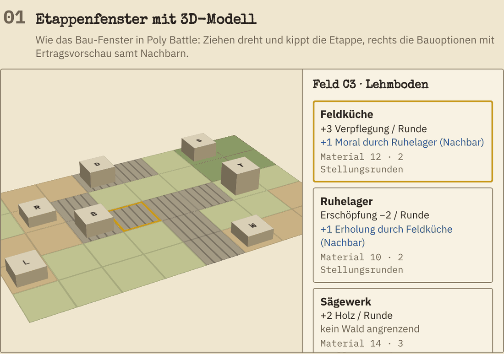

Bewegt: `bilder/etappe-3d.gif`

---

## 7. UI und UX

Grundidee wie in Poly Battle: freie Karte, Bedienung in Kärtchen an den Rändern, ein Schild am gewählten Objekt, Aktionen als Werkzeugreihe unten. Mobile-first, weil asynchroner Multiplayer Handy bedeutet. Alle Bilder in diesem Abschnitt stammen aus dem interaktiven Mockup (Anhang A), das ist gezeichnete Karte und echte Bedienung, keine Simulation.

### 7.1 Look

- **Generalstabskarte als Spielfeld (Stil 01, der Tag)**: Die Karte sieht aus wie eine gedruckte Lagekarte auf leicht vergilbtem Papier. Höhenlinien, Signaturen für Wald, Sumpf, Dorf. Eigene Gräben in Blau, feindliche in Rot, wie mit Buntstift nachgezogen. Zusätzlich Schraffur und Form, damit es ohne Farbe lesbar bleibt
- **Nacht (Stil 04)**: Dasselbe Blatt bei Dunkelheit, fast schwarzes Papier, Tinte hell, Leuchtkugeln als einzige warme Lichtquelle. Der Wechsel ist ein Spielzustand, kein Theme (Abschnitt 7.7)
- **Gedrucktes (Stil 03)**: Telegramme, Stabsbefehle, Briefe, Tagebuch und Gefallenenliste sind Schreibmaschine auf Formular, mit Stempel, zu jeder Tageszeit gleich
- **Ein Look für alle Zoomstufen**: Durchgehend handgezeichnete Kartensymbolik. Die lebendige Draufsicht beim Hineinzoomen kommt, wenn überhaupt, nach 1.0
- **Wetter auf dem Papier**: Regen hinterlässt Wasserflecken, Leuchtkugeln erhellen Kreise, Nebel legt Grau über die Karte
- **Typografie**: Schreibmaschinenschrift für Berichte und Telegramme, klare Grotesk für Werte
- **Farben**: gedämpft (Lehm, Oliv, Papier, Tinte), Akzente nur für Zustände (Rot Gefahr, Gelb vorgemerkt)
- **Regeln wie bei Poly Battle**: keine Verlaufs- oder Glow-Rahmen, keine Neonfarben, dezente Rahmen, hoher Kontrast. Hell- und Dunkelmodus des Systems gelten für Menüs und Feldzugskarte, im Gefecht bestimmt die Tageszeit

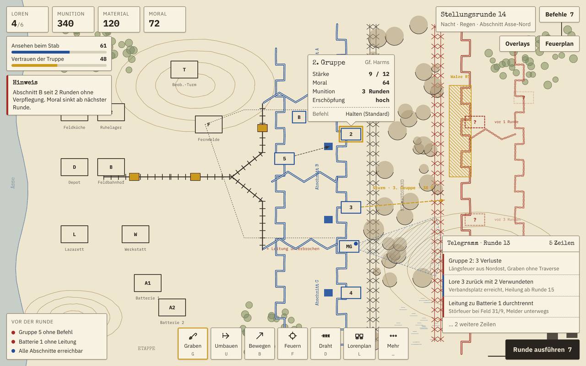

### 7.2 Bildschirmaufbau Gefecht

```
+-----------------------------------------------------------------+
| [Loren 4/6] [Mun 340] [Mat 120] [Moral 72]   Stellungsrunde 14  |
| [Ansehen 61 | Vertrauen 48]                  Nacht, Regen       |
|                                              [Befehle: 7]       |
| [Hinweis: Abschnitt B                        [Overlays]         |
|  ohne Verpflegung]                           [Feuerplan]        |
|                 Lagekarte (frei zoom- und schiebbar)            |
|                                                                 |
|                    +------------------+                         |
|                    | 2. Gruppe  Harms |  <- Schild am Objekt    |
|                    | Stärke 9/12      |                         |
|                    | Moral 64  Mun 3  |                         |
|                    | Halten (Standard)|                         |
|                    +------------------+                         |
|                                                                 |
| [Graben] [Umbauen] [Bewegen] [Feuern] [Draht] [Lorenplan] [Mehr]|
|                                        [ Runde ausführen (7) ]  |
+-----------------------------------------------------------------+
```

Auf dem Handy klappen die Kärtchen oben zu einer Leiste zusammen, Schild und Werkzeugreihe bleiben.

### 7.3 Befehle und Bestätigung

- **Ein Commit**: Befehle sind bis „Runde ausführen" frei änderbar, mit Undo (Strg+Z) und einer **Befehlsliste** als Kärtchen, die alle geplanten Befehle zeigt. Klick springt zur Gruppe
- **Zusammenfassung vor der Ausführung**: Sturmgruppen, Feuerpläne, Munitionsreichweite, Gruppen ohne Befehl, abgeschnittene Abschnitte. Ist ein Sturm dabei, muss der Knopf gehalten werden
- **Standardbefehl Halten**: Gruppen ohne Befehl halten. Du musst nicht jede Gruppe anfassen
- **Zugbefehle**: „Zug 1 greift Abschnitt C an" verteilt den Befehl auf die Gruppen des Zuges
- **Höchstens acht Gruppen** pro Mission, damit Planen nicht länger dauert als Spielen
- **Vorschau**: Jeder Befehl zeigt vorher Trefferchance, Deckung, erwartete Verluste, Dauer in Runden, bei Stürmen den Abstand zur Feuerwalze
- **Rundenende-Checkliste**: Gruppen ohne Befehl, wenig Munition, abgeschnitten, Leitung unterbrochen
- **Radiales Befehlsmenü**: Lang drücken auf eine Gruppe öffnet die Befehle im Kreis um den Finger, die Zielwahl folgt direkt. Die Werkzeugreihe bleibt für Maus und Tastatur

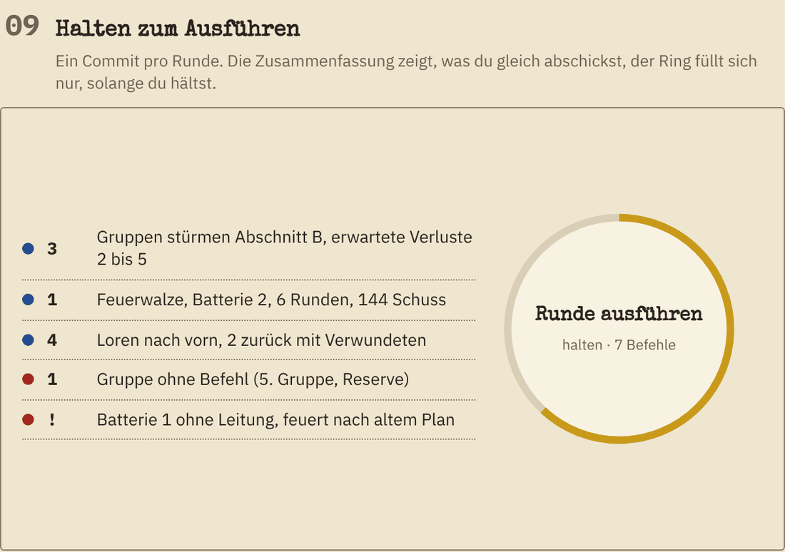

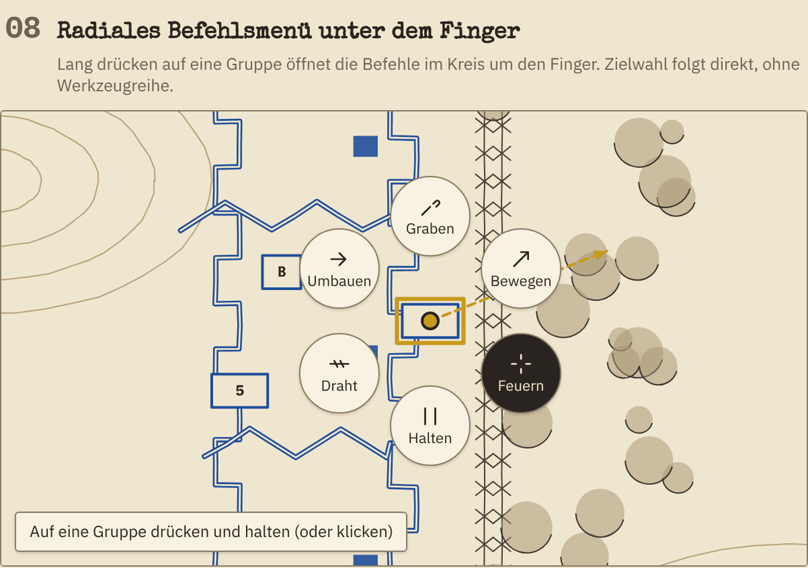

### 7.4 Karte und Overlays

- **Befehlspfeile und Kegel**: Jeder Befehl wird gezeichnet, der ganze Plan ist vor der Ausführung sichtbar
- **Overlays** (Tasten 1 bis 4): Versorgung (Loren als fließende Punkte, Engpässe schraffiert), Bedrohung (bekannte MG-Kegel, Artilleriereichweite, zuletzt gesehene Bewegung mit Alter in Runden), Sicht, Höhe
- **Graben zeichnen**: Mit Finger oder Maus als Linie. Das Spiel zerlegt sie in Felder, zeigt Dauer in Stellungsrunden und bietet „Traversen einfügen" an, wenn ein Abschnitt längsfeuergefährdet ist
- **Feuerplan-Editor**: Startlinie und Richtung ziehen, Schritt und Dauer einstellen, die Walze wird als Zeitleiste über der Karte gezeigt, Sturmgruppen als Geister entlang ihres Pfads
- **Sichtlinien**: Beim Zeigen auf ein Feld werden Sichtlinien der gewählten Gruppe gezeichnet
- **Lorenplan als Zug**: Die Versorgung einer Stellungsrunde ist ein Zug mit so vielen Wagen, wie Loren zur Verfügung stehen. Tippen wechselt die Ladung, der Kreis das Ziel. Verwundete fahren auf denselben Wagen zurück

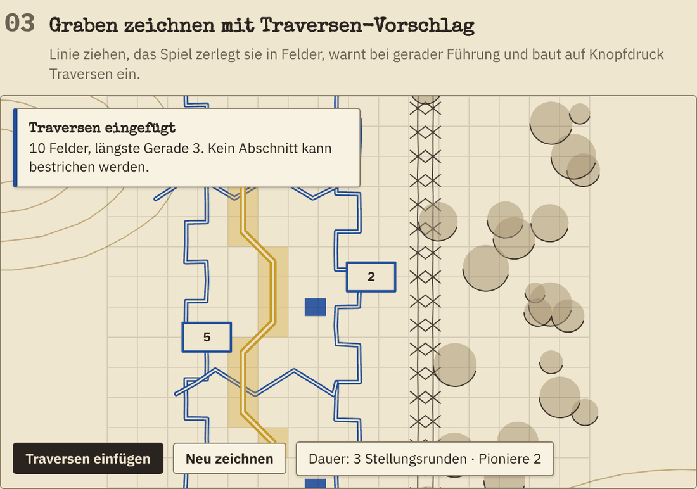

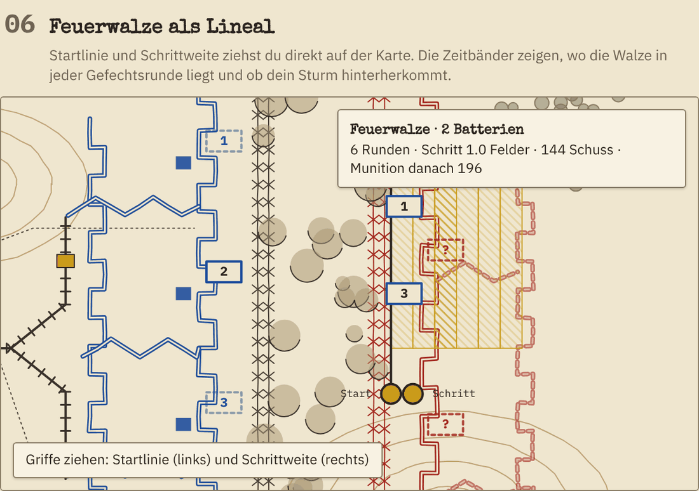

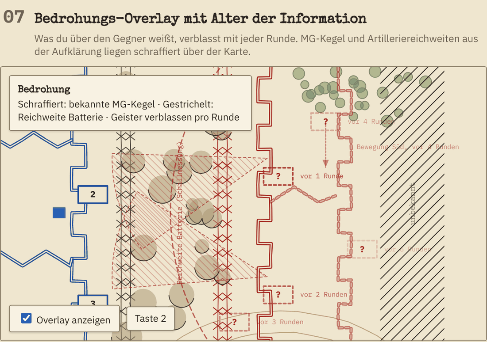

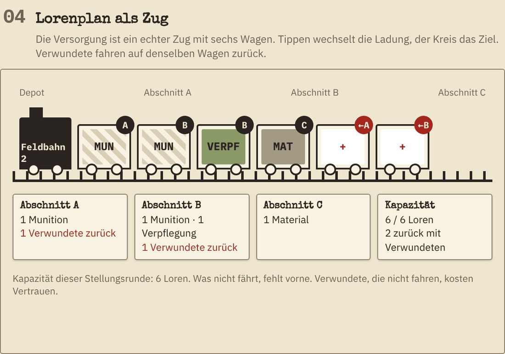

### 7.5 Ausführung und Bericht

- **Phasenfilm**: Die Runde läuft in Phasen ab, „Weiter" pro Phase, Überspringen möglich. Scrubbing kommt später; weil alles deterministisch ist, lässt sich jede Phase aus dem Startzustand neu rechnen
- **Telegramm**: Jede Zeile hat eine Begründung aus dem Ereignisprotokoll („Gruppe 2: 3 Verluste, Längsfeuer aus Nordost, Graben ohne Traverse"). Klick springt zur Stelle
- **Taktik-Lehrling**: Die KI zeigt auf Wunsch, was sie an deiner Stelle tun würde, und erklärt warum. Nutzt dieselbe KI wie der Gegner
- **Eine Uhr für zwei Zeitmaßstäbe**: Die Tag-Nacht-Scheibe der Stellungsrunden wird beim Angriff zur Stoppuhr mit Fünf-Minuten-Schritten. So sieht man immer, in welchem Zeitmaßstab man gerade plant
- **Papierebene**: Briefe, Telegramme und Fundstücke liegen als echte Blätter über der Karte, kippen mit der Maus und kommen beim Antippen nach vorn

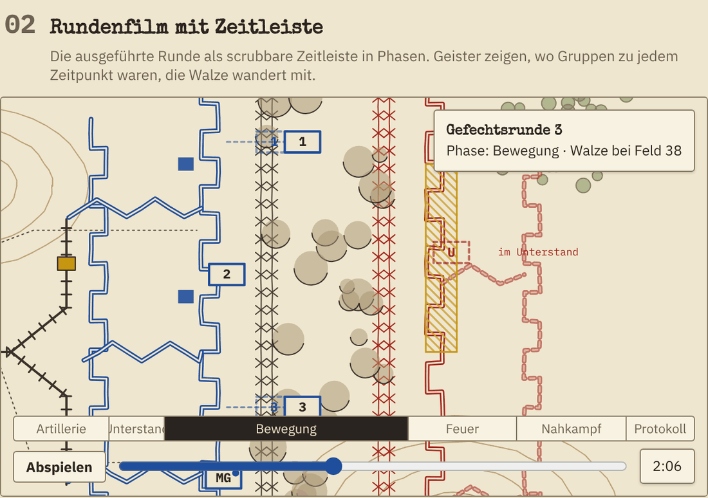

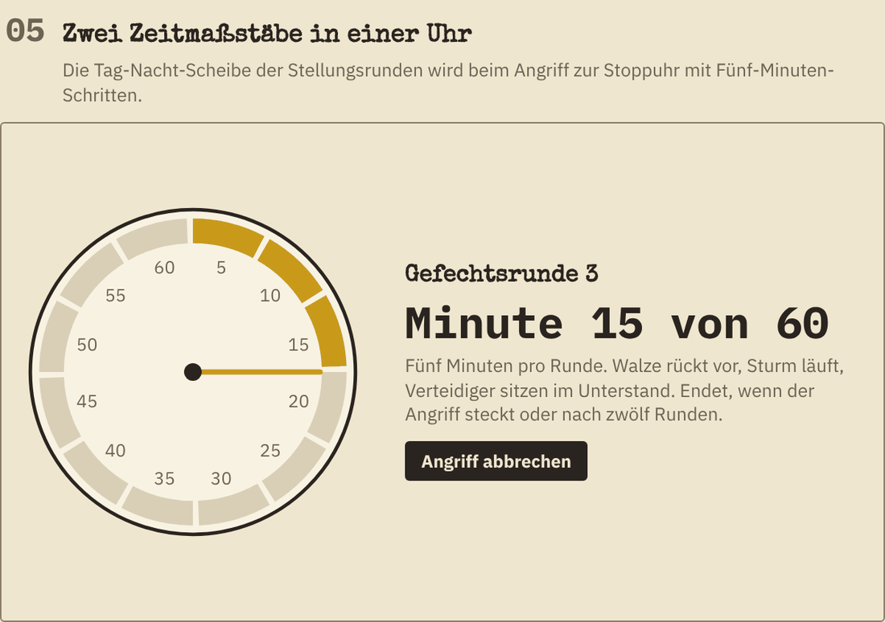

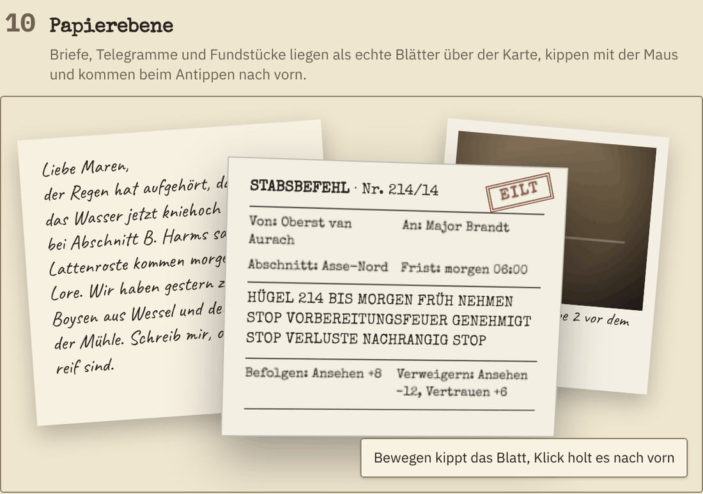

### 7.6 Tastatur und Touch

| Taste | Wirkung |
|---|---|
| Leertaste | Nächste Gruppe ohne Befehl |
| Enter | Runde ausführen (öffnet Zusammenfassung) |
| G, U, B, F, H, D, L | Graben, Umbauen, Bewegen, Feuern, Halten, Draht, Lorenplan |
| 1 bis 4 | Overlays |
| Tab | Befehlsliste |
| Strg+Z | Letzten Befehl zurücknehmen |
| Esc | Abbrechen |
| Pfeile, Ziehen, Pinch | Karte bewegen und zoomen |

### 7.7 Tageszeit als Stilwechsel

Die Lagekarte hat zwei Zustände und einen Übergang. Nichts davon ist ein Theme, das der Spieler wählt; es ist die Spielzeit.

| Zustand | Stil | Wann |
|---|---|---|
| Tag | 01 Generalstabskarte | Stellungsrunden am Tag und die Gefechtsrunden, die aus ihnen entstehen |
| Nacht | 04 Nacht | Stellungsrunden in der Nacht und ihre Gefechtsrunden |
| Übergang | Interpolation zwischen 01 und 04 mit warmem Dämmerungsschimmer | Am Ende des Phasenfilms beim Rundenwechsel, etwa zwei Sekunden |
| Gedrucktes | 03 Feldtelegramm | Telegramme, Stabsbefehle, Briefe, Tagebuch, Gefallenenliste, zu jeder Tageszeit |

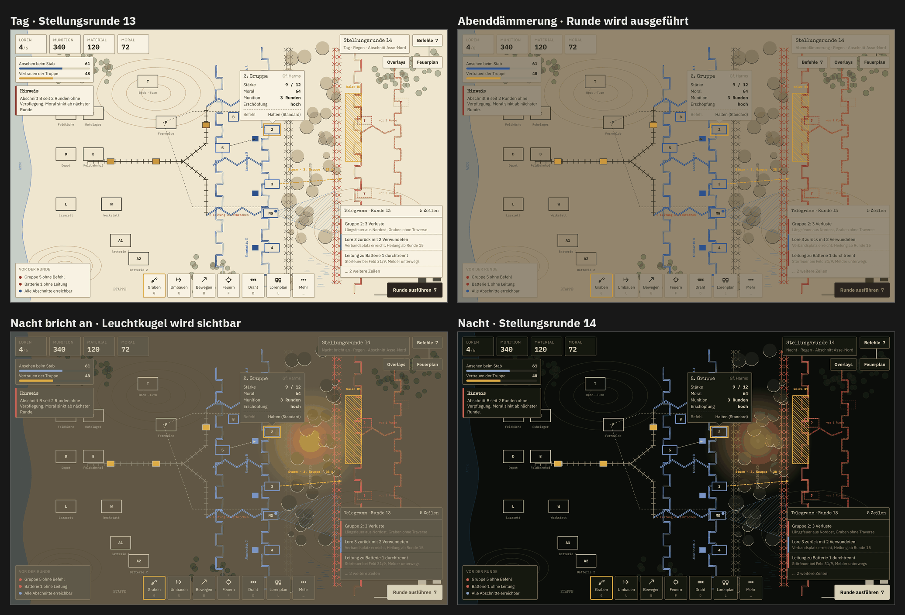

Regeln:
- Ein Faktor `darkness` von 0 (Tag) bis 1 (Nacht) steuert gleichzeitig das Canvas-Thema der Karte, die CSS-Variablen der Kärtchen und die Sichtweite der Regeln: `visibility = 1 − 0,6 · darkness` außerhalb von Leuchtkugeln. Optik und Regel hängen am selben Wert und laufen nie auseinander
- Papier und Kärtchen wandern linear. Tinte, Linien und die Signaturfarben Blau und Rot springen spät und schnell um (zwischen `darkness` 0,45 und 0,7). Wandert alles gleichzeitig, verliert der Text in der Mitte des Übergangs den Kontrast; das zeigte das Mockup sofort
- Dämmerung bekommt einen warmen Schimmer: Papier und Kärtchen werden zur Mitte des Übergangs hin in Richtung Braunorange gemischt, Gewicht `sin(π · darkness) · 0,35`
- Leuchtkugeln werden ab `darkness > 0,5` gezeichnet. Nachts sind sie die einzige warme Lichtquelle, Regen hinterlässt Wasserflecken bei jeder Tageszeit
- Eine Nachtrunde wird als Nacht geplant: Der Übergang läuft am Ende des Phasenfilms, danach ist die Karte dunkel, und alle Vorschauen (Trefferchance, Sicht) rechnen schon mit der Nachtsicht. Der Spieler sieht beim Planen das, was gilt
- Gefechtsrunden erben die Tageszeit ihrer Stellungsrunde. Ein Angriff, der bei Nacht angesetzt wird, bleibt Nacht, auch wenn er zwölf Gefechtsrunden dauert
- Der Systemmodus (hell oder dunkel) gilt nur für Menüs, Feldzugskarte und Briefe zwischen den Missionen

Umsetzung: `js/theme.js` hält `DAY` und `NIGHT` als Objekte mit denselben Schlüsseln, `lerpTheme(DAY, NIGHT, darkness)` liefert das Zwischenthema, `applyTheme(theme)` setzt die CSS-Variablen und stößt `render.js` an. Der funktionierende Code dazu steht im Mockup, Auszug in Anhang A.

### 7.8 Stilvarianten aus dem Mockup

Derselbe Gefechtsbildschirm in zehn Stilen, nur der Stil ist gewechselt. Das war die Entscheidungsgrundlage für 7.1 und 7.7.

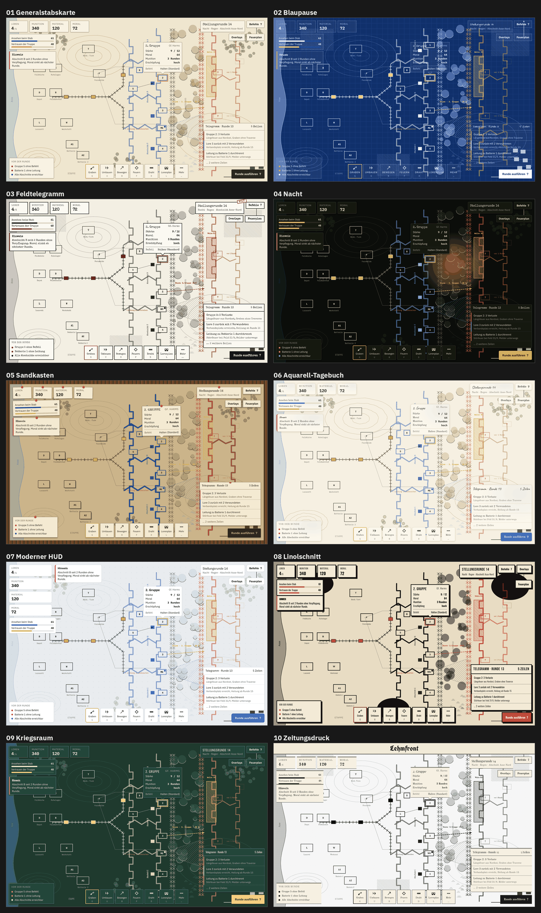

| Nr. | Stil | Entscheidung |
|---|---|---|
| 01 | Generalstabskarte | **Der Tag.** Hauptlook des Spiels |
| 02 | Blaupause | Verworfen als Spielfeld, aber die Idee bleibt für den Feuerplan-Editor: technische Zeichnung auf Blau, wenn man eine Walze plant |
| 03 | Feldtelegramm | **Alles Gedruckte.** Telegramme, Stabsbefehle, Briefe, Gefallenenliste |
| 04 | Nacht | **Die Nacht.** Übergang aus 01, siehe 7.7 |
| 05 | Sandkasten | Verworfen. Holzrahmen und Pins sind nett, fressen auf dem Handy Platz |
| 06 | Aquarell-Tagebuch | Nur für Brandts Tagebuch zwischen den Missionen |
| 07 | Moderner HUD | Verworfen als Look, aber die Seitenleiste ist die richtige Anordnung für schmale Hochkant-Displays |
| 08 | Linolschnitt | Nur für Titelbild, Aktkarten und Erfolge. Im Gefecht zu grob |
| 09 | Kriegsraum | Verworfen. Kandidat für die Feldzugskarte, wenn 01 dort zu nah am Gefecht wirkt |
| 10 | Zeitungsdruck | Nur für Zwischentexte („Was die Zeitungen schreiben") zwischen den Akten |

Einzelbilder aller Stile liegen unter `bilder/stil-01-generalstabskarte.png` bis `bilder/stil-10-zeitungsdruck.png`.

---

## 8. Inhalt und Modi

| Inhalt | Umfang | Spielzeit | Stufe |
|---|---|---|---|
| Kampagne Akt 1 „Erstarrung" | 6 Missionen à 25 bis 40 Min, Tutorial integriert | ca. 3,5 Std | 1.0 |
| Gefecht frei | 4 Karten plus Zufallskarten, beide Fraktionen, 3 Schwierigkeiten | offen | 1.0 |
| Tageslage | Eine Endlos-Woche mit festem Seed, Bestenliste | 20 Min pro Tag | 1.0 |
| Hotseat | Zwei Spieler an einem Gerät | offen | 1.0 |
| Endlosmodus „Frontabschnitt" | Wochen als Zyklen, Jahreszeiten, derselbe Abschnitt | offen | 1.1 |
| Wochenlage | Vier Endlos-Wochen mit festem Seed | 1 bis 2 Std pro Woche | 1.1 |
| Online-Gefechte | Asynchron gegen Freunde | offen | 1.1 |
| Kampagne Akte 2 bis 4 | 18 Missionen | ca. 10 Std | 1.2 bis 1.4 |
| Nebenmissionen | 8 Stoßtrupp- und Pioniermissionen | ca. 2,5 Std | 1.2 bis 1.4 |
| Puzzle-Lagen | 12 kleine Karten mit voller Information und einer Lösung | ca. 2 Std | 1.5 |
| Stellungsbau-Sandbox | Gräben zeichnen ohne Gegner, Längsfeuer-Analyse, Export als Missionsstart | offen | 1.5 |
| Missionseditor | Im Spiel, JSON-Export, Teilen über Supabase | offen | 1.5 |
| Fundstücke und Erfolge | 24 Fundstücke, 40 Erfolge | Langzeitmotivation | laufend |

### 8.1 Kampagne „Der Lehmgau"

**Akt 1: Erstarrung (Sommer)** – 6 Missionen
Brandt übernimmt den Abschnitt an der Asse. Der Bewegungskrieg endet, die ersten Gräben werden ausgehoben. Die Missionen führen die zwölf Kernmechaniken einzeln ein: Graben und Feuerrichtung, Feuer und Unterdrückung, Lorenplan, Feuerplan mit Beobachter, Schlamm, Ablösung. Erste Stabsbefehle, erste Gefallenenliste. Endet mit der ersten großen Gegenoffensive von Haus Morrow, die gehalten werden muss. Lasks Doktrin: Masse.

**Akt 2: Lehm und Regen (Herbst)** – 6 Missionen
Die Regenzeit kommt, Gräben laufen voll. Stollenkrieg unter Hügel 214, erste Stoßtrupps, Offiziere, Doktrinwahl. Vell will einen Angriff erzwingen. Entscheidung: Brandt hält ihn auf (Ansehen sinkt, Vertrauen steigt) oder lässt ihn gehen (umgekehrt, und Vell kann fallen). Lasks Doktrin: Nachtangriffe.

**Akt 3: Materialschlacht (Winter)** – 6 Missionen
Der Stab will den Durchbruch. Feuerwalzen, Gas, Flugzeuge. Brandt bekommt Befehle, die sie für sinnlos hält. Abgefangene Briefe von Lask zeigen, dass es drüben genauso aussieht. Lask bietet eine Waffenruhe an. Entscheidungen: Befehl ausführen, umdeuten oder verweigern. Lasks Doktrin: Materialschlacht.

**Akt 4: Das letzte Frühjahr** – 6 Missionen
Beide Seiten sind erschöpft. Ein Panzerwagen-Prototyp, eine gewaltige Mine, Gerüchte über Verhandlungen, Verweigerungen. Der Akt endet in einem der vier Enden aus Ansehen und Vertrauen (Abschnitt 2.6). Lasks Doktrin: Tiefe Verteidigung.

### 8.2 Missionsarten

- Halten bis zur Ablösung
- Stellung nehmen, umbauen und gegen Gegenstoß sichern
- Stollen graben, bevor der Gegner deinen findet
- Nachtangriff mit Stoßtrupp, Gefangene einbringen
- Versorgungskrise: Gleis unter Beschuss wiederaufbauen, Lorenplan mit zu wenig Loren
- Rettung: eingeschlossene Gruppe mit Sanitätern bergen
- Rückzug: geordnet absetzen, ohne dass die Linie bricht
- Täuschung: Gegner glauben lassen, der Angriff komme woanders
- Gegenstoß auf Befehl: verlorenen Graben zurücknehmen, obwohl die Truppe erschöpft ist

### 8.3 Endlosmodus „Frontabschnitt"

- Derselbe Abschnitt, dieselben Männer, Wochen als Zyklen. Eine Woche sind 14 Stellungsrunden plus die Angriffe, die sich daraus ergeben
- Pro Woche ein generierter Stabsbefehl (Halten, Feld X nehmen, Stoßtrupp, Gefangene, Graben zurücknehmen) mit Ansehensfolgen
- Jahreszeit wechselt alle sechs Wochen, Gegner wird pro Woche stärker, Ersatz hängt am Ansehen
- Generierte Feldpost und Gefallenenliste laufen weiter, deshalb hängt man an den Leuten
- Ende, wenn der Abschnitt fällt, Brandt abgelöst wird oder die Truppe meutert
- Score: gehaltene Wochen x 100, gewonnene Felder x 5, geborgene Verwundete x 2, minus Gefallene x 3. Bestenliste nur nach Nachrechnen des Befehlsprotokolls auf dem Server
- Beide Fraktionen spielbar

---

## 9. Multiplayer

| Modus | Beschreibung | Stufe |
|---|---|---|
| **Hotseat** | Zwei Spieler an einem Gerät. Nach den Befehlen erscheint ein Übergabebildschirm, der Gegner sieht nichts vom Plan | 1.0 |
| **Asynchron 1 gegen 1** | Beide geben Befehle ab, sobald beide da sind, rechnet die Edge Function die Runde. Frist 48 Stunden, danach gilt „Halten". Stellungsrunden ein Zug pro Tag, Gefechtsrunden in einer Sitzung oder mit kurzer Frist. Einladung per Code wie in Poly Battle | 1.1 |
| **Replay-Link** | Seed und Befehlsprotokoll als Code oder URL, der Empfänger spielt lokal ab. Kein Server nötig. Lange Partien liegen in einer Tabelle `replays` mit kurzer ID | 1.1 |
| **Koop gegen KI** | Zwei Spieler teilen Abschnitt, Depot und Loren. Leichter zu balancen als PvP | 1.5 |

Balancing: Spiegelkarten mit gleicher Fraktion zuerst, asymmetrische Fraktionen im PvP erst, wenn die KI-gegen-KI-Turniere ausgeglichene Siegquoten liefern.

---

## 10. Technik

Gleicher Ansatz wie Poly Battle: kein Build-Schritt, ES-Module, Bibliotheken liegen im Repo unter `vendor/`, Service Worker für Offline-Spielen, Logik als reine, getestete Funktionen.

### 10.1 Stack

| Bereich | Wahl | Grund |
|---|---|---|
| Darstellung | Canvas 2D, zwei Ebenen (Karte statisch, Einheiten und Overlays dynamisch) | Lagekarte, Gräben als Pfade, reicht völlig, spart Akku auf dem Handy |
| Tageszeit | Ein Faktor `darkness` 0 bis 1 steuert Canvas-Thema, CSS-Variablen und Sichtweite (7.7) | Optik und Regel hängen am selben Wert |
| Raster | Quadrate, 10 Meter pro Feld | Gräben mit Diagonalen sehen richtig aus, Sichtlinie per Bresenham, Zickzack-Analyse einfach |
| Logik | Reine Funktionen in `rules.js`, `resolve.js`, `supply.js`, `map.js` | Deterministisch, testbar, laufen im Browser und in der Edge Function |
| Zufall | mulberry32 mit Seed | Gleiche Befehle plus gleicher Seed ergeben gleiches Ergebnis |
| Sicht und Pfade | Eigene Bresenham-Sichtlinie und A*; optional rot.js aus `vendor/rot/` für Schattenwurf-Sichtfeld | rot.js liegt als ES-Module vor und lädt ohne Build-Schritt |
| Online | Supabase (supabase-js UMD unter `vendor/`), Edge Functions in Deno | Spielstände, asynchrone Gefechte, nachgerechnete Bestenliste |
| Tests | `node --test` | wie in Poly Battle |
| Hosting | GitHub Pages direkt aus `main` | |

### 10.2 Projekt anlegen

```bash
mkdir lehmfront && cd lehmfront
git init -b main
mkdir -p js css vendor/supabase vendor/rot assets data/maps data/missions data/letters test tools docs supabase/migrations supabase/functions/_shared supabase/functions/resolve
npm init -y
npm install @supabase/supabase-js@2 rot-js
cp node_modules/@supabase/supabase-js/dist/umd/supabase.js vendor/supabase/supabase.js
cp -r node_modules/rot-js/lib/. vendor/rot/
printf "node_modules/\n" > .gitignore
git add .
git commit -m "Grundgerüst"
gh repo create lehmfront --public --source=. --push
echo '{"source":{"branch":"main","path":"/"}}' | gh api -X POST "repos/{owner}/{repo}/pages" --input -
```

Die UMD-Datei stellt `window.supabase` bereit und wird in `index.html` mit `<script src="vendor/supabase/supabase.js"></script>` eingebunden. rot.js wird bei Bedarf als Modul importiert: `import { FOV, Path } from './vendor/rot/index.js'`.

`package.json` ergänzen:

```json
{
  "type": "module",
  "scripts": {
    "test": "node --test",
    "sim": "node tools/sim.js",
    "sync-shared": "cp js/config.js js/rng.js js/rules.js js/map.js js/supply.js js/resolve.js supabase/functions/_shared/",
    "deploy-fn": "npm run sync-shared && supabase functions deploy resolve"
  }
}
```

Lokal testen:

```bash
npx serve . -l 8080
```

### 10.3 Ordnerstruktur

```
index.html
sw.js                    Service Worker
css/style.css
js/
  config.js              Einheiten, Gebäude, Erfahrungsberichte, Fraktionen, Balancing
  rng.js                 Zufall mit Seed
  rules.js               Regeln: Deckung, Feuer, Graben, Nahkampf
  map.js                 Gelände, Höhe, Gräben mit Feuerrichtung, Krater, Sichtlinien
  supply.js              Depot, Loren, Laufgräben, Sanitätskette
  resolve.js             Rundenauflösung in Phasen, Stellungs- und Gefechtsrunde, Ereignisprotokoll
  view.js                Gefilterte Sicht pro Seite (Nebel des Krieges)
  ai.js                  KI-Kommandant mit Lagen und Doktrinen
  render.js              Lagekarte, Overlays, Phasenfilm
  theme.js               Tag- und Nachtthema, Interpolation für den Übergang (7.7)
  ui.js                  Kärtchen, Schild, Werkzeugreihe, Befehlsliste, Feuerplan-Editor
  campaign.js            Missionen, Briefe, Entscheidungen, Ansehen, Vertrauen
  letters.js             Generierte Feldpost aus Vorlagen und Ereignisprotokoll
  net.js                 Supabase
  save.js                Speichern mit Versionsfeld und Migrationen
  main.js
data/
  names.json             Namenslisten pro Fraktion
  maps/                  Karten als JSON
  missions/              Missionen als JSON
  letters/               Handgeschriebene Briefe, Vorlagen, Tagebuch
tools/
  sim.js                 Headless-Simulator für KI-gegen-KI-Turniere
test/
  rules.test.js
  resolve.test.js
supabase/
  migrations/0001_init.sql
  functions/_shared/     Kopie der reinen Spiellogik (npm run sync-shared)
  functions/resolve/index.ts
```

### 10.4 Zufall mit Seed (`js/rng.js`)

```js
// mulberry32: klein, schnell, deterministisch
export function createRng(seed) {
  let a = seed >>> 0;
  return function next() {
    a = (a + 0x6d2b79f5) >>> 0;
    let t = a;
    t = Math.imul(t ^ (t >>> 15), t | 1);
    t ^= t + Math.imul(t ^ (t >>> 7), t | 61);
    return ((t ^ (t >>> 14)) >>> 0) / 4294967296;
  };
}
```

### 10.5 Kern der Feuerregel (`js/rules.js`)

Gegenüber Version 1: Feuerrichtung (`reversed`), Unterstand (`inDugout`), kein `NaN` bei unbekannter Deckung, Unterdrückung pro Schuss waffenabhängig, Begründung im Ergebnis.

```js
export const COVER = {
  open: 0,
  crater: 0.35,
  foxhole: 0.45,
  trench: 0.6,
  trench_improved: 0.7,
  trench_concrete: 0.8,
};

/**
 * Wirksame Deckung eines Feldes.
 * reversed: eroberter Graben, Schützenauftritt zeigt in die falsche Richtung
 * enfilade: Längsfeuer entlang eines Grabens ohne Traverse
 */
export function coverValue(cover, { enfilade = false, reversed = false } = {}) {
  let c = COVER[cover] ?? 0;
  if (reversed) c *= 0.5;
  if (enfilade) c *= 0.3;
  return c;
}

/**
 * Trefferchance eines Schusses einer Gruppe auf eine andere.
 * distance in Feldern, visibility 0..1 (Nacht, Nebel, Rauch), suppressed 0..1, experience 0..4
 */
export function hitChance({ distance, range, cover, visibility, experience, suppressed, enfilade = false, reversed = false }) {
  if (distance > range || visibility <= 0) return 0;

  const rangeFactor = 1 - (distance / range) * 0.6;
  const skill = 0.8 + experience * 0.1;
  const shakiness = 1 - suppressed * 0.6;

  const p = 0.35 * rangeFactor * (1 - coverValue(cover, { enfilade, reversed })) * visibility * skill * shakiness;
  return Math.max(0, Math.min(0.95, p));
}

/** Feuer einer Gruppe ausführen: Verluste und Unterdrückung beim Ziel */
export function resolveFire(rng, shooter, target, ctx) {
  // Im Unterstand ist eine Gruppe für Direktfeuer unerreichbar, feuert aber auch nicht
  if (target.inDugout) return { hits: 0, suppression: target.suppressed, reason: 'Ziel im Unterstand' };

  const p = hitChance({
    distance: ctx.distance,
    range: shooter.range,
    cover: target.cover,
    visibility: ctx.visibility,
    experience: shooter.experience,
    suppressed: shooter.suppressed,
    enfilade: ctx.enfilade,
    reversed: target.reversed,
  });

  let hits = 0;
  for (let i = 0; i < shooter.shots; i++) {
    if (rng() < p) hits++;
  }

  // Unterdrückung pro Schuss hängt von der Waffe ab (Gewehr 0.01, leichtes MG 0.02, sMG 0.03)
  const suppression = Math.min(1, target.suppressed + shooter.shots * shooter.suppressionPerShot + hits * 0.1);
  const reason = ctx.enfilade ? 'Längsfeuer, Graben ohne Traverse' : target.reversed ? 'eroberter Graben noch nicht umgebaut' : null;
  return { hits, suppression, reason };
}
```

Testdatei `test/rules.test.js` (läuft mit `npm test`, alle acht Tests grün geprüft):

```js
import { test } from 'node:test';
import assert from 'node:assert/strict';
import { hitChance, resolveFire } from '../js/rules.js';
import { createRng } from '../js/rng.js';

const base = { distance: 3, range: 6, visibility: 1, experience: 1, suppressed: 0 };

test('Graben schützt besser als offenes Feld', () => {
  assert.ok(hitChance({ ...base, cover: 'trench' }) < hitChance({ ...base, cover: 'open' }));
});

test('Längsfeuer hebelt Grabendeckung aus', () => {
  assert.ok(hitChance({ ...base, cover: 'trench', enfilade: true }) > hitChance({ ...base, cover: 'trench' }));
});

test('eroberter Graben schützt weniger als eigener', () => {
  assert.ok(hitChance({ ...base, cover: 'trench', reversed: true }) > hitChance({ ...base, cover: 'trench' }));
});

test('unbekannte Deckung zählt als offen, nie NaN', () => {
  assert.equal(hitChance({ ...base, cover: 'kaputt' }), hitChance({ ...base, cover: 'open' }));
});

test('außer Reichweite kein Treffer', () => {
  assert.equal(hitChance({ ...base, distance: 7, cover: 'open' }), 0);
});

test('im Unterstand keine Treffer', () => {
  const rng = createRng(1);
  const r = resolveFire(rng, { shots: 12, range: 6, experience: 2, suppressed: 0, suppressionPerShot: 0.01 },
                             { cover: 'trench', suppressed: 0, inDugout: true }, { distance: 2, visibility: 1, enfilade: false });
  assert.equal(r.hits, 0);
});

test('gleicher Seed, gleiche Folge', () => {
  const a = createRng(42), b = createRng(42);
  for (let i = 0; i < 1000; i++) assert.equal(a(), b());
});

test('gleicher Seed, gleiches Feuerergebnis', () => {
  const shooter = { shots: 10, range: 6, experience: 1, suppressed: 0, suppressionPerShot: 0.01 };
  const target = { cover: 'open', suppressed: 0 };
  const ctx = { distance: 3, visibility: 1, enfilade: false };
  const r1 = resolveFire(createRng(7), shooter, target, ctx);
  const r2 = resolveFire(createRng(7), shooter, target, ctx);
  assert.deepEqual(r1, r2);
});
```

```bash
npm test
```

### 10.6 Rundenauflösung (`js/resolve.js`)

Eine Funktion `resolveTurn(state, ordersA, ordersB, seed, turn)` liefert `{ state, log, finished }`. Der Zufallsgenerator wird pro Runde aus `seed` und `turn` abgeleitet, damit jede Runde einzeln nachrechenbar ist.

**Stellungsrunde**
1. Beide Befehlslisten einsammeln, nach Gruppen-ID sortieren
2. Wetter würfeln, Schlamm in Senken fortschreiben
3. Artillerie: Störfeuer und Gegenbatteriefeuer, Krater anlegen, Leitungen und Gleise prüfen
4. Graben, Umbauen, Bauen, Draht, Entwässerung
5. Stollen vortreiben, Horchposten würfeln
6. Bewegung und Ablösung hinter der Front, nachts Stoßtrupps
7. Loren fahren: Güter nach vorne, Verwundete zurück, Vorräte der Abschnitte aktualisieren
8. Moral, Erschöpfung, Heilung, Erfahrungsberichte zählen
9. Angriff angesetzt? Dann `turnKind = 'battle'` und Feuerpläne scharf schalten
10. Ereignisprotokoll zurückgeben

**Gefechtsrunde**
1. Befehle einsammeln
2. Artillerie: aktueller Schritt jedes Feuerplans, Umlenken mit Verzögerung je nach Leitung
3. Unterstand: Gruppen unter Beschuss gehen hinein, Gruppen ohne Beschuss kommen nach einer Runde heraus
4. Bewegung, Draht verlangsamt, Begegnungen erzeugen Nahkampf
5. Feuer mit dem Zustand nach der Bewegung, Unterdrückung
6. Nahkampf Feld für Feld
7. Unterdrückung klingt ab, Moralproben
8. Angriff zu Ende? Dann `turnKind = 'position'`
9. Ereignisprotokoll zurückgeben

**Ereignisprotokoll mit Begründung**, von Anfang an:

```js
{ phase: 'fire', type: 'losses', group: 'k2', amount: 3, from: 'm5', cause: 'enfilade',
  reason: 'Längsfeuer aus Nordost, Graben ohne Traverse', at: { x: 41, y: 17 } }
```

`view.js` erzeugt daraus pro Seite eine gefilterte Sicht: eigene Einheiten vollständig, feindliche nur, wenn sie in Sicht sind, sonst als Geist mit Alter in Runden. Dieselbe Funktion läuft im Browser (Singleplayer, Hotseat) und in der Edge Function (Online).

### 10.7 Determinismus

- Befehle, Gruppen und Ereignisse immer nach ID sortieren, nie auf Objekt-Reihenfolge oder instabile Sortierung verlassen
- In `rules.js`, `resolve.js`, `supply.js`, `map.js` nur Grundrechenarten, `Math.imul`, `floor`, `min`, `max`. Keine transzendenten Funktionen (`Math.sin`, `Math.exp`, `Math.pow` mit Bruchexponenten), weil Safari und V8 dort in der letzten Stelle abweichen können
- Keine Abhängigkeit von `Date`, `Math.random` oder DOM in diesen Dateien
- Test: gleicher Zustand, gleiche Befehle, gleicher Seed zweimal durch `resolveTurn` ergibt tief gleiche Ergebnisse

### 10.8 Speichern

Jeder Spielstand trägt `version`. `save.js` hält eine Liste von Migrationen `v1 → v2 → ...`, die alte Stände beim Laden anheben. Lokal in IndexedDB, in der Cloud in `saves.data`.

### 10.9 Headless-Simulator (`tools/sim.js`)

Für Balancing und KI-Turniere ohne Browser:

```bash
node tools/sim.js --map data/maps/asse.json --seed 42 --a halten --b sturm --runs 200
```

Gibt Siegquote, mittlere Verluste, Rundenzahl und die zehn häufigsten Begründungen aus. Ein Turnier aller KI-Lagen gegeneinander läuft vor jeder Balancing-Änderung. Symmetrie-Test: identische Armeen auf gespiegelter Karte müssen über 1000 Läufe nahe 50 Prozent landen.

---

## 11. Supabase

### 11.1 Funktionen
- **Cloud-Spielstand** mit Profil-Code wie in Poly Battle
- **Tages- und Wochenlage**: Der Client schickt sein Befehlsprotokoll an die Edge Function `submit-daily`, die rechnet nach und schreibt den Score. Clients schreiben nie selbst in die Bestenliste
- **Asynchrone Online-Gefechte**: Befehle werden abgegeben, die Edge Function `resolve` rechnet, sobald beide da sind
- **Verdeckte Befehle**: Fremde Befehle sind erst nach der Runde lesbar (RLS)
- **Verdeckter Zustand**: Der volle Zustand liegt in `match_states` ohne Policy, also nur für die Service-Role erreichbar. Jeder Spieler bekommt seine gefilterte Sicht in `match_views` per Realtime

### 11.2 Schema (`supabase/migrations/0001_init.sql`, Syntax gegen Postgres 16 geprüft)

```sql
create table public.profiles (
  id uuid primary key references auth.users(id) on delete cascade,
  username text unique check (char_length(username) between 3 and 20),
  created_at timestamptz not null default now()
);

create table public.saves (
  user_id uuid not null default auth.uid() references public.profiles(id) on delete cascade,
  slot smallint not null check (slot between 1 and 5),
  version integer not null default 1,
  data jsonb not null,
  updated_at timestamptz not null default now(),
  primary key (user_id, slot)
);

create table public.matches (
  id uuid primary key default gen_random_uuid(),
  map_id text not null,
  seed integer not null,
  player_a uuid not null default auth.uid() references public.profiles(id) on delete cascade,
  player_b uuid references public.profiles(id) on delete cascade,
  turn integer not null default 1,
  turn_kind text not null default 'position' check (turn_kind in ('position', 'battle')),
  deadline timestamptz,
  status text not null default 'waiting' check (status in ('waiting', 'active', 'finished')),
  winner uuid references public.profiles(id),
  created_at timestamptz not null default now()
);

-- Voller Zustand inklusive verdeckter Einheiten: nur die Edge Function (Service-Role) liest und schreibt
create table public.match_states (
  match_id uuid primary key references public.matches(id) on delete cascade,
  state jsonb not null,
  updated_at timestamptz not null default now()
);

-- Gefilterte Sicht pro Spieler (Nebel des Krieges)
create table public.match_views (
  match_id uuid not null references public.matches(id) on delete cascade,
  user_id uuid not null references public.profiles(id) on delete cascade,
  turn integer not null,
  view jsonb not null,
  primary key (match_id, user_id)
);

create table public.match_orders (
  match_id uuid not null references public.matches(id) on delete cascade,
  turn integer not null,
  user_id uuid not null default auth.uid() references public.profiles(id) on delete cascade,
  orders jsonb not null,
  created_at timestamptz not null default now(),
  primary key (match_id, turn, user_id)
);

-- Tages- und Wochenlage: Ergebnis wird von der Edge Function nachgerechnet und eingetragen
create table public.daily_results (
  day date not null,
  user_id uuid not null references public.profiles(id) on delete cascade,
  score integer not null,
  weeks_held integer not null,
  orders jsonb not null,
  created_at timestamptz not null default now(),
  primary key (day, user_id)
);

alter table public.profiles      enable row level security;
alter table public.saves         enable row level security;
alter table public.matches       enable row level security;
alter table public.match_states  enable row level security;
alter table public.match_views   enable row level security;
alter table public.match_orders  enable row level security;
alter table public.daily_results enable row level security;

create policy "profile lesbar" on public.profiles for select using (true);
create policy "eigenes profil anlegen" on public.profiles for insert to authenticated with check (id = auth.uid());
create policy "eigenes profil aendern" on public.profiles for update to authenticated using (id = auth.uid()) with check (id = auth.uid());

create policy "eigene saves" on public.saves for all to authenticated
  using (user_id = auth.uid()) with check (user_id = auth.uid());

create policy "teilnehmer sehen match" on public.matches for select to authenticated
  using (auth.uid() in (player_a, player_b) or status = 'waiting');
create policy "match anlegen" on public.matches for insert to authenticated
  with check (player_a = auth.uid());

-- match_states bekommt absichtlich keine Policy

create policy "eigene sicht" on public.match_views for select to authenticated
  using (user_id = auth.uid());

-- Eigene Befehle immer sichtbar, fremde erst wenn die Runde vorbei ist
create policy "befehle lesen" on public.match_orders for select to authenticated
  using (
    user_id = auth.uid()
    or exists (
      select 1 from public.matches m
      where m.id = match_orders.match_id
        and auth.uid() in (m.player_a, m.player_b)
        and m.turn > match_orders.turn
    )
  );

create policy "eigene befehle abgeben" on public.match_orders for insert to authenticated
  with check (
    user_id = auth.uid()
    and exists (
      select 1 from public.matches m
      where m.id = match_orders.match_id
        and m.status = 'active'
        and m.turn = match_orders.turn
        and auth.uid() in (m.player_a, m.player_b)
    )
  );

create policy "bestenliste lesbar" on public.daily_results for select using (true);

alter publication supabase_realtime add table public.matches, public.match_views;
```

Beitreten (`player_b` setzen, Status auf `active`, Startzustand anlegen) läuft über eine Edge Function `join`, nicht über eine Update-Policy, damit niemand fremde Partien verändert.

### 11.3 Edge Function `resolve` (Skizze, `supabase/functions/resolve/index.ts`)

```ts
import { createClient } from 'npm:@supabase/supabase-js@2';
import { resolveTurn } from '../_shared/resolve.js';
import { viewFor } from '../_shared/view.js';

Deno.serve(async (req) => {
  const { matchId } = await req.json();

  // Wer ruft? JWT des Spielers prüfen
  const caller = createClient(Deno.env.get('SUPABASE_URL')!, Deno.env.get('SUPABASE_ANON_KEY')!, {
    global: { headers: { Authorization: req.headers.get('Authorization') ?? '' } },
  });
  const { data: { user } } = await caller.auth.getUser();
  if (!user) return new Response('unauthorized', { status: 401 });

  // Voller Zugriff nur hier drin
  const admin = createClient(Deno.env.get('SUPABASE_URL')!, Deno.env.get('SUPABASE_SERVICE_ROLE_KEY')!);

  const { data: match } = await admin.from('matches').select('*').eq('id', matchId).single();
  if (!match || ![match.player_a, match.player_b].includes(user.id)) return new Response('forbidden', { status: 403 });

  const { data: orders } = await admin.from('match_orders').select('user_id, orders')
    .eq('match_id', matchId).eq('turn', match.turn);
  if (!orders || orders.length < 2) return Response.json({ waiting: true });

  // Doppelaufruf absichern: nur wer die Runde als Erster weiterzählt, rechnet
  const { data: claimed } = await admin.from('matches')
    .update({ turn: match.turn + 1 }).eq('id', matchId).eq('turn', match.turn).select('id');
  if (!claimed || claimed.length === 0) return Response.json({ busy: true });

  const { data: st } = await admin.from('match_states').select('state').eq('match_id', matchId).single();
  const ordersA = orders.find((o) => o.user_id === match.player_a)!.orders;
  const ordersB = orders.find((o) => o.user_id === match.player_b)!.orders;

  const { state, log, finished } = resolveTurn(st!.state, ordersA, ordersB, match.seed, match.turn);

  await admin.from('match_states').update({ state, updated_at: new Date().toISOString() }).eq('match_id', matchId);
  await admin.from('match_views').upsert([
    { match_id: matchId, user_id: match.player_a, turn: match.turn + 1, view: viewFor(state, log, 'a') },
    { match_id: matchId, user_id: match.player_b, turn: match.turn + 1, view: viewFor(state, log, 'b') },
  ]);
  await admin.from('matches').update({
    turn_kind: state.turnKind,
    status: finished ? 'finished' : 'active',
    winner: finished ? state.winner : null,
    deadline: new Date(Date.now() + 48 * 3600 * 1000).toISOString(),
  }).eq('id', matchId);

  return Response.json({ ok: true, turn: match.turn + 1 });
});
```

Die Spiellogik liegt als Kopie unter `supabase/functions/_shared/`, weil der CLI-Deploy nur bündelt, was unter `supabase/functions/` liegt. `npm run deploy-fn` kopiert und deployt. Die Umgebungsvariablen `SUPABASE_URL`, `SUPABASE_ANON_KEY` und `SUPABASE_SERVICE_ROLE_KEY` stellt Supabase in Edge Functions automatisch bereit.

---

## 12. Meilensteine

Zeiten sind Vollzeitwochen; neben der Schule eher das Anderthalbfache.

### M1: Ein Graben, zwei Gruppen (2 Wochen)
- Lagekarte mit Gelände, Höhe, Zoom und Verschieben (Maus und Touch)
- Graben zeichnen und ausheben, Feuerrichtung, Traversen, Deckung, Sichtlinien
- Feuer und Unterdrückung, Stellungs- und Gefechtsrunde, Phasenfilm, Telegramm mit Begründungen
- Tests für `rules.js` und Determinismus
- **Ziel**: Ein Gefecht 3 gegen 3 mit einem Sturm ist schon spannend

### M2: Online-Durchstich (1 Woche)
- Schema aus 11.2, Edge Function `resolve` mit `_shared`, gefilterte Sichten, zwei Browser spielen eine Runde gegeneinander
- **Ziel**: Die Architektur für verdeckten Zustand steht, bevor viel UI darauf gebaut wird

### M3: Gefecht vollständig (3 Wochen)
- Feuerpläne mit Feuerwalze, Beobachter, Leitungen, Melder, Gegenbatteriefeuer
- Unterstände und Wettlauf zum Grabenrand, Draht, Krater, Schlamm, Wetter, Tag und Nacht mit Übergang beim Rundenwechsel (7.7)
- Lorenplan, Depot, Gleise, Laufgräben, Sanitätskette
- KI-Kommandant mit Lagen Halten, Vorbereiten, Sturm, Gegenstoß; Taktik-Lehrling
- Headless-Simulator und erstes Turnier

### M4: Etappe, Rahmen, Speichern (3 Wochen)
- Etappe auf der Karte mit Nachbarboni und Etappenstufen
- Ansehen, Vertrauen, Stabsbefehle, Erfahrungsberichte, Ersatz, Ablösung
- Generierte Feldpost, Gefallenenliste, Tagebuch
- Speichern lokal und in Supabase mit Versionsfeld, Hotseat

### M5: Release 1.0 (4 Wochen)
- Akt 1 mit 6 Missionen, Tutorial integriert, handgeschriebene Briefe
- Gefecht frei mit beiden Fraktionen, Tageslage mit `submit-daily`
- Look festziehen: Lagekarte, Wetter auf Papier, Hell- und Dunkelmodus, Handy-Layout
- Balancing per Turnier, Sound

### Danach
- **1.1** (3 Wochen): Online gegen Freunde mit Einladungscode und Fristen, Replay-Link, Endlosmodus, Wochenlage
- **1.2 bis 1.4** (je 3 bis 4 Wochen): Akte 2 bis 4 mit ihren Mechaniken, Nebenmissionen, Fundstücke, Erfolge, vier Enden
- **1.5** (3 Wochen): Koop, Missionseditor, Sandbox, Puzzle-Lagen

---

## 13. Risiken

| Risiko | Gegenmaßnahme |
|---|---|
| Umfang wächst wieder | Alles außerhalb der zwölf Kernmechaniken wartet auf seine Stufe. Neue Ideen landen in `docs/ideen.md`, nicht im Code |
| Gleichzeitige Züge fühlen sich zufällig an | Begründung zu jedem Ereignis, Bedrohungs-Overlay aus Aufklärung, Vorschau vor jedem Befehl, Phasenfilm |
| Planen dauert länger als Spielen | Höchstens acht Gruppen, Standardbefehl Halten, Zugbefehle, Checkliste statt Pflichtklicks |
| KI zu schwach im Stellungskrieg | Regelsätze pro Lage, Lasks Doktrin pro Akt, Taktik-Lehrling nutzt dieselbe KI, Turniere im Simulator |
| Balancing | KI-gegen-KI-Turniere vor jeder Änderung, Symmetrie-Test, Spiegelkarten im PvP zuerst |
| Inhalt ist viel Arbeit | Missionen als JSON mit Editor, generierte Feldpost, Akte nacheinander |
| Ton kippt ins Verherrlichende | Fiktive Welt, Gefallenenliste mit Namen, Verluste wiegen auf Vertrauen, Briefe aus Sicht der Menschen, keine Orden-Zählung |
| Schummeln online | Zustand nur auf dem Server, gefilterte Sichten, Bestenliste nur nach Nachrechnen |
| Determinismus bricht zwischen Browsern | Regeln aus 10.7, Determinismus-Test in jeder Testlauf, Server rechnet immer maßgeblich |
| Handy zu langsam | Zwei Canvas-Ebenen, Karte nur bei Änderung neu zeichnen, keine Partikel in 1.0 |

---

## 14. Referenzen

**Ton und Management**
- [All Quiet in the Trenches](https://store.steampowered.com/app/863500/All_Quiet_in_the_Trenches/): Vorgesetzte gegen Insubordination, Lagerpflichten, Dialoge. Reviews loben genau diesen Teil und kritisieren Überladung und unklares Feedback ([Hands-on](https://turnbasedlovers.com/news/strategy-survival-all-quiet-in-the-trenches-hands-on))
- [Dig In](https://store.steampowered.com/app/2152500/Dig_In/): Graben-Koloniesim, Befehle per Melder brauchen Zeit, benannte Soldaten mit Hintergrund

**Mechanik-Realismus**
- [The Great War: Western Front](https://store.steampowered.com/app/2109370/The_Great_War_Western_Front/) und die Kritik dazu auf [ACOUP](https://acoup.blog/2023/05/05/collections-the-great-war-western-front-a-gain-of-inches/): Feuerrichtung der Gräben, Wettlauf zum Grabenrand, Schlamm als Logistikstrafe, Artillerie nach Plan, Rotation statt Sofortauffüllung

**WEGO**
- [Frozen Synapse](https://www.wikiwand.com/en/articles/Frozen_Synapse): gleichzeitige Runden, asynchroner Multiplayer mit vielen parallelen Partien
- [Phantom Brigade](https://lute-mauve-px9l.squarespace.com/simultaneous-turn-combat-system): Zeitleiste, Geist-Vorschau, Feuerkegel beider Seiten; Planen dauert länger als Ausführen ([Review](https://pcgamer.com/phantom-brigade-review))

**Code zum Lesen**
- [OpenPanzer](https://www.github.com/nicupavel/openpanzer): Panzer General 2 in reinem JavaScript mit Canvas, Szenarien als XML, Ausrüstung als JSON. GPL, also lesen, nicht kopieren
- [epoh](https://github.com/tautvilas/epoh): rundenbasiertes Browser-Strategiespiel mit Node-Server

**Bibliotheken**
- [rot.js](https://cdn.jsdelivr.net/npm/rot-js@2.2.1/manual/pages/fov.html): Sichtfeld per Schattenwurf mit Callback pro Feld, [Pfadsuche](https://cdn.jsdelivr.net/npm/rot-js@2.2.1/manual/pages/path.html). `lib/` ist reines ES-Module und lädt ohne Build-Schritt
- [Red Blob Games](https://redblobgames.com/grids/hexagons): Rastermathematik, falls doch Hex

---

## Anhang A: UI-Mockup

Alles in Abschnitt 7 Gezeigte ist eine einzige HTML-Datei mit Platzhaltern: Die Karte ist gezeichnet, nicht simuliert, aber Stile, Tageszeit und die zehn Bedienideen sind echt und anklickbar.

### A.1 Dateien

| Datei | Inhalt |
|---|---|
| `ui/lehmfront-ui.html` | Fertig gebaut, Schriften eingebettet (etwa 630 KB). Im Browser öffnen, fertig. Leiste oben: Stil, Ansicht (Gefecht oder 10 Features), Tageszeit-Regler |
| `ui/template.html` | Quelle ohne eingebettete Schriften, zum Lesen und Ändern (etwa 80 KB). Der Platzhalter `/*FONTS*/` wird beim Bauen ersetzt |
| `ui/build.mjs` | Bettet die Schriften aus den fontsource-Paketen als Base64 ein |
| `ui/shoot.mjs` | Screenshots aller Stile, Features und Tageszeiten mit Playwright |
| `ui/package.json`, `ui/README.md` | Abhängigkeiten und Kurzanleitung |
| `bilder/` | Alle Screenshots: `stil-01` bis `stil-10`, `feature-01` bis `feature-10`, `tagnacht-*`, drei Übersichtsblätter, `etappe-3d.gif` |

```bash
cd ui
npm install
npm run build
npx playwright install chromium
npm run shots
```

### A.2 Aufbau des Codes

- **Stile** sind CSS-Variablen pro `body[data-style]` (Papier, Kärtchen, Tinte, Linien, Blau, Rot, Akzent, Schriften, Radius, Rahmen, Schatten) plus ein Objekt `THEMES[stil]` für die Canvas-Karte (Farben, Zittern der Bleistiftlinien, Raster, Schraffur, Leuchtkugel). Ein Stil ist also ein Satz Token, kein eigener Code
- **Karte**: `drawMap(canvas, theme, {view, layers})` zeichnet die ganze Szene in Rasterkoordinaten (48 x 30 Felder) und bekommt einen Ausschnitt `view` und Schalter `layers`. Dieselbe Funktion zeichnet den Gefechtsbildschirm und alle Mini-Karten der Features, nur mit anderem Ausschnitt. Gräben sind Rechteckwellen (`crenel`), Laufgräben Zickzack (`zagH`), Bleistiftlinien zittern deterministisch über mulberry32
- **Features** sind je ein abgeschlossener Block mit eigenem Canvas oder DOM und einer `window.__f…`-Funktion, mit der der Screenshot-Lauf einen Zustand setzt
- **Tageszeit**: siehe A.3. Die Werte für Tag kommen aus den CSS-Variablen des aktuellen Stils, die für Nacht aus Stil 04

### A.3 Code-Auszug: Tag-Nacht-Übergang

So steht es im Mockup (`ui/template.html`), gekürzt um die Oberfläche. Für das Spiel wandert das nach `js/theme.js`.

```js
// Stil 01 (Karte) ist der Tag, Stil 04 (Nacht) die Nacht. Dazwischen wird interpoliert:
// Canvas-Thema und CSS-Variablen der Kärtchen gleichzeitig, mit warmem Dämmerungsschimmer.
const CSSVARS_NACHT = {
  paper:'#0b0d0a', card:'#15180f', ink:'#d8d2b8', ink2:'#8f8a73', line:'#3a3f2c',
  track:'#262a1e', own:'#7fa4e6', enemy:'#e2645a', accent:'#ffbf47', danger:'#e2645a',
};

function hex2rgb(h) {
  h = h.replace('#', '');
  if (h.length === 3) h = h.split('').map(c => c + c).join('');
  const n = parseInt(h, 16);
  return [n >> 16 & 255, n >> 8 & 255, n & 255];
}
function rgb2hex(r) {
  return '#' + r.map(v => Math.round(Math.max(0, Math.min(255, v))).toString(16).padStart(2, '0')).join('');
}
function mix(a, b, t) {
  if (!a.startsWith('#') || !b.startsWith('#')) return t < .5 ? a : b;
  const A = hex2rgb(a), B = hex2rgb(b);
  return rgb2hex(A.map((v, i) => v + (B[i] - v) * t));
}

// Zwischenthema für die Canvas-Karte
function lerpTheme(day, night, t) {
  const out = {};
  for (const k of new Set([...Object.keys(day), ...Object.keys(night)])) {
    const va = day[k], vb = night[k] ?? va;
    // Tinte und Signaturfarben springen spät und schnell um, Papier wandert linear
    const late = ['ink', 'own', 'enemy', 'accent', 'wire', 'rail'].includes(k)
      ? Math.max(0, Math.min(1, (t - .45) / .25)) : t;
    if (typeof va === 'string' && va.startsWith('#') && typeof vb === 'string') out[k] = mix(va, vb, late);
    else if (typeof va === 'number' && typeof vb === 'number') out[k] = va + (vb - va) * t;
    else out[k] = t < .5 ? va : vb;
  }
  const d = Math.sin(Math.PI * t);                // Dämmerung: warmer Schimmer auf dem Papier
  out.paper = mix(out.paper, '#9c7a4f', d * .35);
  out.faint = mix(out.faint, '#7a5c3a', d * .3);
  out.flare = t > .5;                             // Leuchtkugeln erst, wenn es dunkel genug ist
  return out;
}

// CSS-Variablen der Kärtchen nachziehen und Karte neu zeichnen
function applyDayNight(t) {
  const body = document.body;
  body.style.cssText = '';                        // Tageswerte des aktuellen Stils lesen
  const cs = getComputedStyle(body);
  const tInk = Math.max(0, Math.min(1, (t - .45) / .25));
  for (const k of Object.keys(CSSVARS_NACHT)) {
    const day = cs.getPropertyValue('--' + k).trim();
    const spring = ['ink', 'ink2', 'line', 'own', 'enemy', 'accent', 'danger'].includes(k);
    let v = mix(day, CSSVARS_NACHT[k], spring ? tInk : t);
    if (k === 'paper') v = mix(v, '#9c7a4f', Math.sin(Math.PI * t) * .35);
    if (k === 'card')  v = mix(v, '#8a6a44', Math.sin(Math.PI * t) * .25);
    body.style.setProperty('--' + k, v);
  }
  currentTheme = lerpTheme(THEMES[body.dataset.style], THEMES.nacht, t);
  redrawMap();
}
```

Im Spiel kommt `t` nicht vom Regler, sondern aus `resolve.js`: Die Stellungsrunde trägt `night: true|false`, der Phasenfilm animiert `t` in seiner letzten Sekunde von der alten zur neuen Tageszeit, und `rules.js` liest dieselbe Zahl als `visibility = 1 − 0.6 · t`.

### A.4 Bildverzeichnis

| Bild | Zeigt |
|---|---|
| `bilder/uebersicht-stile.png` | Alle zehn Stile nebeneinander |
| `bilder/uebersicht-features.png` | Alle zehn Feature-Demos |
| `bilder/uebersicht-tagnacht.png` | Tag, Abenddämmerung, Nacht bricht an, Nacht |
| `bilder/stil-NN-name.png` | Je ein Stil in voller Größe (1280 x 800) |
| `bilder/feature-NN-name.png` | Je ein Feature |
| `bilder/tagnacht-tag.png`, `-abend.png`, `-daemmerung.png`, `-nacht.png` | Die vier Zustände einzeln |
| `bilder/etappe-3d.gif` | Das drehbare Etappenfenster in Bewegung |
