# Lehmfront: Anleitung für Einsteiger

Diese Anleitung führt dich in etwa zwanzig Minuten von null bis zur ersten eigenen Partie. Sie ergänzt zwei Dinge im Spiel selbst:

- **Grundausbildung** (Hauptmenü, oberster Eintrag): ein Zettel führt dich Schritt für Schritt durch die erste Partie an der Asse. Etwa zehn Minuten.
- **Handbuch** (Hauptmenü unten, im Gefecht unter Menü, Reiter Tasten): alle Begriffe, Werte und Tasten zum Nachschlagen.

Spielen: https://hjorven.github.io/lehmfront/ (Desktop, Tablet und Handy, ohne Installation, danach auch offline)

---

## Inhalt

1. [Worum es geht](#1-worum-es-geht)
2. [Starten](#2-starten)
3. [Der Bildschirm](#3-der-bildschirm)
4. [Die erste Runde](#4-die-erste-runde)
5. [Ausführen, Film und Telegramm](#5-ausführen-film-und-telegramm)
6. [Versorgung, Etappe, Ablösung](#6-versorgung-etappe-ablösung)
7. [Angreifen](#7-angreifen)
8. [Tag, Nacht und Wetter](#8-tag-nacht-und-wetter)
9. [Wenn du nicht weiterweißt](#9-wenn-du-nicht-weiterweißt)
10. [Wie es weitergeht](#10-wie-es-weitergeht)
11. [Bedienung auf Handy und Tablet](#11-bedienung-auf-handy-und-tablet)
12. [Tasten](#12-tasten)
13. [Häufige Fragen](#13-häufige-fragen)

---

## 1. Worum es geht

Du bist **Major Ilse Brandt** und führst einen Frontabschnitt im Lehmgau, an der Asse. Die Welt ist erfunden: die Republik **Kaldern** (blau, du) gegen das Haus **Morrow** (rot, drüben). Du kämpfst nicht selbst, du **planst**: wo gegraben wird, wer vorn liegt, was die Feldbahn fährt und ob überhaupt angegriffen wird.

Drei Dinge machen das Spiel aus:

- **Gleichzeitige Züge (WEGO).** Du gibst Befehle, drüben gibt Hauptmann Lask seine, dann laufen beide gleichzeitig ab. Du planst gegen das, was er vorhaben könnte.
- **Zwei Zeitmaßstäbe.** Eine **Stellungsrunde** dauert zwölf Stunden (Graben, Bauen, Versorgen, Ablösen). Setzt jemand einen Angriff an, wird in **Gefechtsrunden** zu fünf Minuten gespielt.
- **Stab gegen Truppe.** Zwei Werte begleiten dich immer: **Ansehen beim Stab** und **Vertrauen der Truppe**. Der Stab will Gelände, deine Leute wollen leben.

Jede Meldung im Spiel trägt eine Begründung. Wenn etwas schiefgeht, steht da, warum.

## 2. Starten

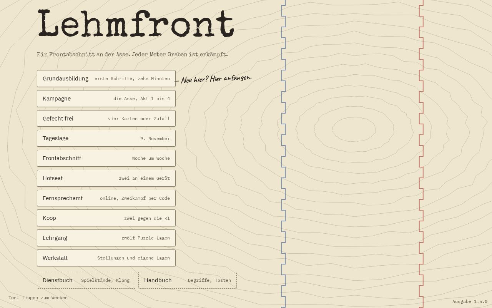

Beim ersten Besuch steht neben **Grundausbildung** mit Bleistift „Neu hier? Hier anfangen.“ Fang dort an. Die Grundausbildung ist eine echte Partie an der Asse gegen den schwächsten Gegner (Rekrut), ohne Rundenlimit. Ein Zettel zeigt dir, was als Nächstes zu tun ist, und umkringelt das passende Bedienelement mit Bleistift. Erledigst du den Schritt auf der Karte, hakt der Zettel ihn selbst ab.

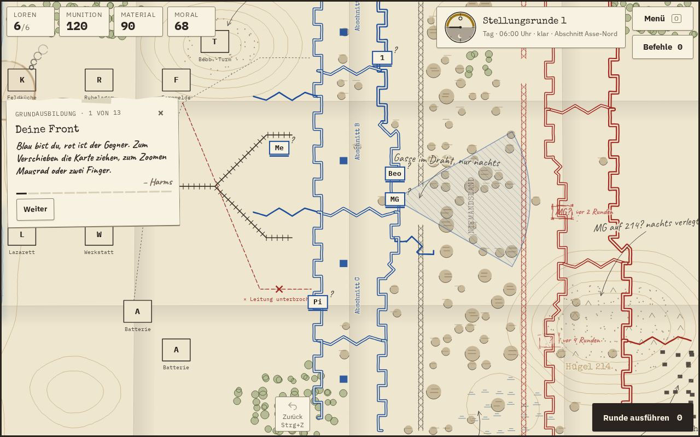

In der Grundausbildung gibt es am Anfang **keinen einzigen Befehl**. Jeder Befehl erscheint erst, wenn der Zettel ihn vorstellt: zuerst Bewegen und Halten, dann Graben, Feuern und am Ende der Lorenplan. Auch „Vor der Runde“ und der Lehrling kommen erst, wenn sie dran sind.

Du kannst jederzeit einen **Vorigen Schritt** zurückgehen, einen Schritt **überspringen** oder den Zettel mit **×** schließen. Der Fortschritt bleibt im Browser gespeichert. ### Befehle kommen Schritt für Schritt

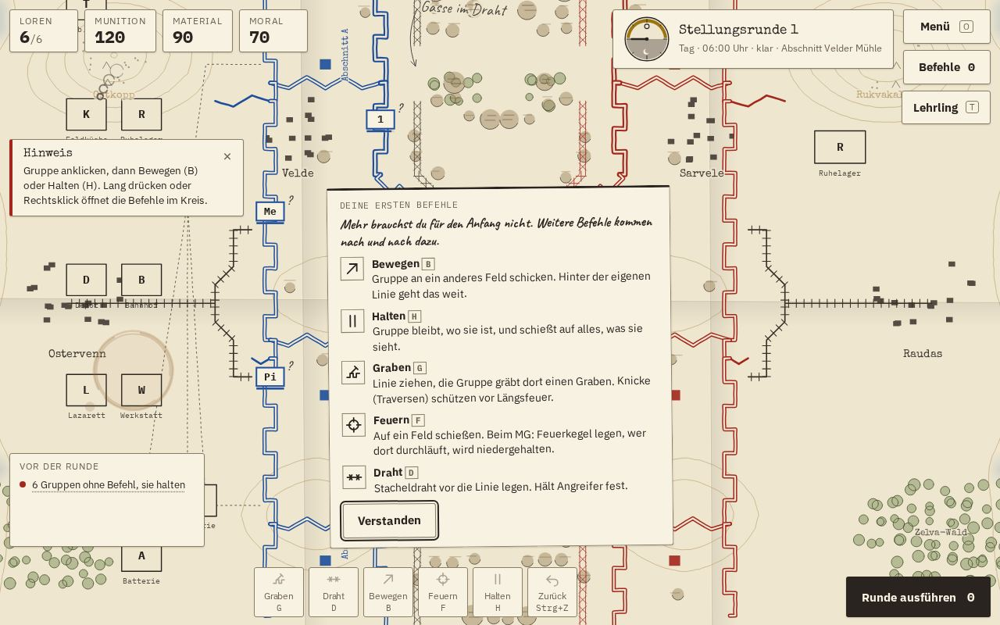

Wer neu ist, bekommt nicht gleich alle 16 Befehle. Neue Befehle stellt jeweils ein Zettel mit einem Satz vor:

| Stufe | Befehle | Kommt mit |
|---|---|---|
| 1 | Bewegen, Halten, Graben | Grundausbildung, Akt 1 Mission 1 |
| 2 | Feuern, Deckung, Draht | Grundausbildung, Mission 2 (in Gefecht frei von Anfang an) |
| 3 | Lorenplan, Ablösen | Ende der Grundausbildung, Mission 3 |
| 4 | Sturm, Feuerplan, Feuer verlegen und einstellen | Mission 4 |
| 5 | Umbauen, Entwässern, Leuchtkugel, Etappe | Mission 5 |

Solange Befehle fehlen, bleiben auch Overlays, Ton und „Karte frei“ weg, und „Vor der Runde“ meldet nichts zu Befehlen, die es noch nicht gibt. Ansehen und Vertrauen stehen nur in der Kampagne. Tageslage, Lehrgang, eigene Lagen, Online und Akt 2 bis 4 zeigen immer alles. Wer schon Erfahrung hat: **Dienstbuch** (Menü), Reiter **Darstellung**, „Befehle im Gefecht: alle von Anfang an“.

Danach empfiehlt das Spiel:

| Wenn du ... | dann |
|---|---|
| eine Geschichte willst | **Kampagne**: Akt 1 bringt jede Mechanik einzeln, mit Hinweisen der Figuren |
| einfach spielen willst | **Gefecht frei**: Karte, Fraktion, Gegner und Dauer wählen. Für Neue ist der Rekrut vorgewählt |
| knobeln willst | **Lehrgang**: zwölf kleine Lagen mit einer festen Lösung |

## 3. Der Bildschirm

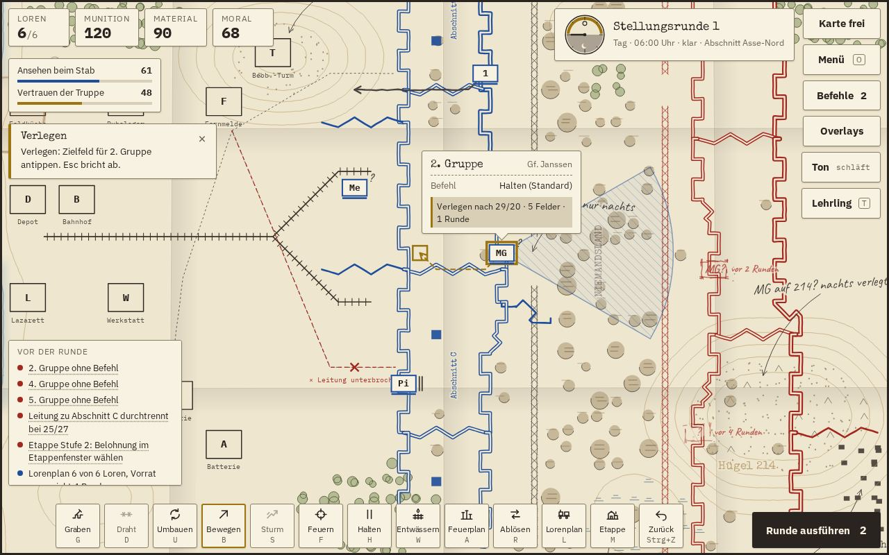

| Wo | Was |
|---|---|
| Oben links | **Loren** (Wagen der Feldbahn, frei/gesamt), **Munition**, **Material**, **Moral**. Darunter **Ansehen** und **Vertrauen**. Mit der Maus darüber fahren erklärt jeden Wert |
| Oben rechts | **Rundenkärtchen** mit Uhr: Stellungsrunde oder Gefechtsrunde, Uhrzeit, Wetter, Abschnitt |
| Rechts | **Karte frei** (Kärtchen beiseite), **Menü** (Dienstbuch: Speichern, Klang, Darstellung), **Befehle** (Liste aller Befehle), **Overlays**, **Ton**, **Lehrling** |
| Links unten | **Vor der Runde**: was noch offen ist. Antippen springt zur Stelle |
| Unten | **Werkzeugreihe** mit allen Befehlen und ihren Tasten, rechts **Runde ausführen** |
| Auf der Karte | Blaue Kästchen sind deine Gruppen (Kürzel: **1** bis **5** Schützen, **MG**, **Beo** Beobachter, **Me** Melder, **Pi** Pioniere). Rote Fragezeichen sind Feinde, die du zuletzt gesehen hast, mit Alter in Runden |

Wählst du eine Gruppe, erscheint ihr **Schild**: Stärke, Moral, Erschöpfung, Erfahrung, Posten und Befehl. Ohne Befehl hält die Gruppe. Das ist erlaubt und oft richtig: Du musst nicht jede Gruppe anfassen.

## 4. Die erste Runde

### Gruppe wählen und bewegen

1. Tippe auf ein blaues Kästchen.
2. Wähle **Bewegen** (Taste B). In einer Stellungsrunde heißt das hinter der eigenen Linie **Verlegen**, das geht viermal so weit.
3. Tippe das Ziel an. Der Pfeil zeigt, wie weit die Gruppe in dieser Runde kommt. Durchgezogen ist diese Runde, gestrichelt der Rest, der in der nächsten Runde weiterläuft.

Mit dem Finger merkt das erste Antippen das Ziel mit Bleistift vor und zeigt Weg und Kosten im Schild, das zweite Antippen setzt den Befehl.

### Der Befehlskreis

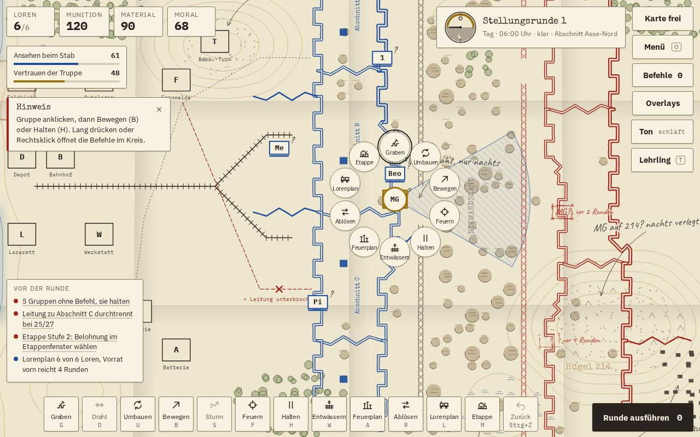

Lang drücken (oder Rechtsklick) auf eine Gruppe öffnet alle Befehle im Kreis. Mit dem Finger kannst du direkt zum Befehl ziehen und loslassen. Graue Einträge gehen gerade nicht; der Grund steht dabei.

### Graben mit Traversen

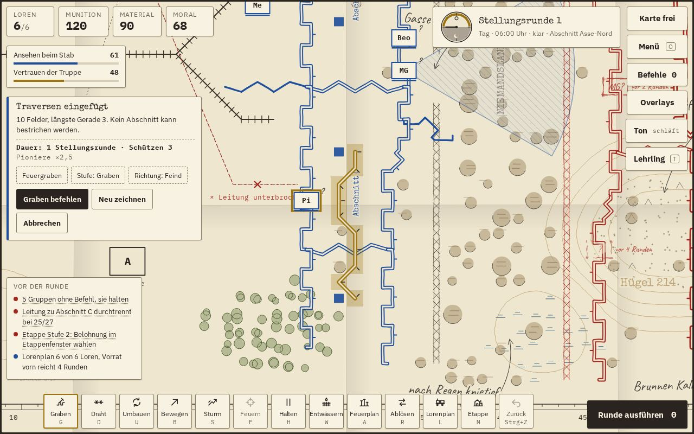

1. Gruppe wählen, **Graben** (G).
2. Eine Linie ziehen. Zurückziehen radiert.
3. Das Kärtchen zeigt Dauer, Stufe und Feuerrichtung.

Wichtig: Lange **gerade** Grabenstücke kann ein MG von der Seite der Länge nach bestreichen (**Längsfeuer**), die Deckung sinkt dann auf ein Drittel. Das Kärtchen warnt und bietet **Traversen einfügen** an: der Graben bekommt Knicke, kein gerades Stück ist länger als drei Felder. Nimm das fast immer an. Pioniere graben zweieinhalbmal so schnell.

### Das MG

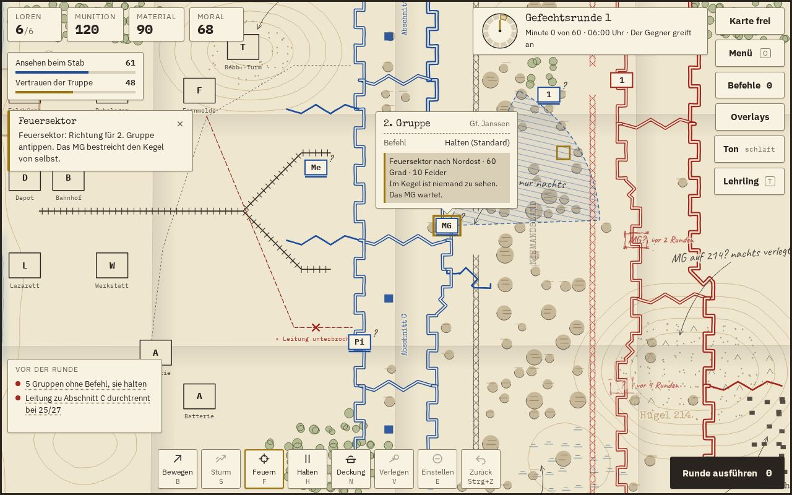

Wähle den MG-Trupp und **Feuern** (F). Beim MG legst du einen **Feuerkegel**. Wer dort durchläuft, wird **niedergehalten**, auch wenn niemand fällt: niedergehaltene Gruppen kommen nur halb so weit und treffen schlechter. Bei Schützengruppen zeigt Feuern vorher Trefferchance, Deckung und erwartete Verluste.

### Wie weit sieht eine Gruppe?

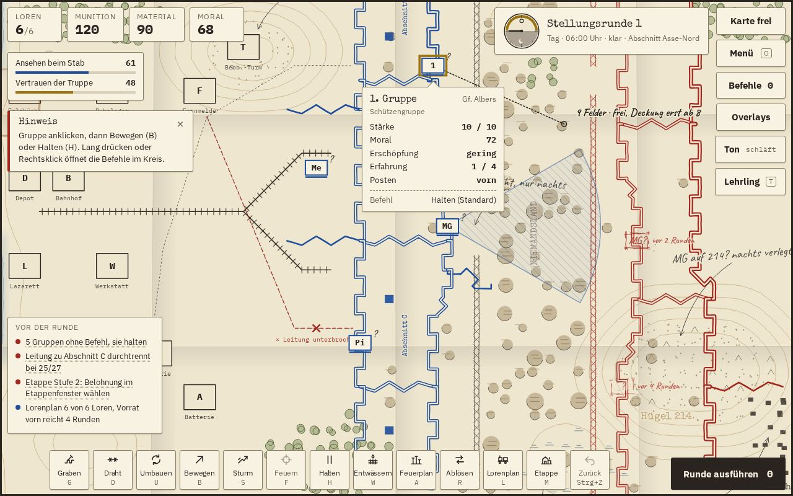

Ist eine Gruppe gewählt, zeigt die Karte beim Zeigen mit der Maus (am Handy: ein leeres Feld antippen) die **Sichtlinie** mit Entfernung: frei, verdeckt (rotes Kreuz) oder zu weit. Wald, Dorf und Hügel verdecken, Höhe sieht weiter. Nachts, im Nebel und im Regen sieht jeder weniger.

### Nichts ist endgültig

Bis zum Ausführen ist alles änderbar. **Zurück** (Strg+Z) nimmt den letzten Befehl zurück, **Befehle** (Tab) zeigt die Liste aller Befehle; ein Klick springt zur Gruppe.

## 5. Ausführen, Film und Telegramm

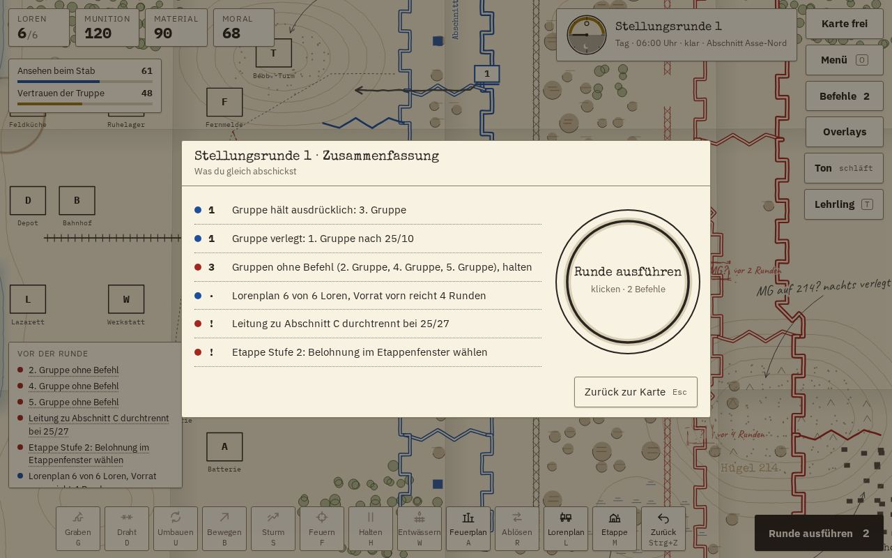

**Runde ausführen** (Enter) zeigt zuerst eine **Zusammenfassung**: was geplant ist, welche Gruppen ohne Befehl halten, wie lange die Vorräte reichen und was noch offen ist. Mit **Zurück zur Karte** (Esc) kannst du nachbessern.

Dann rechnen beide Seiten gleichzeitig. Die Runde läuft als **Film** in Phasen ab:

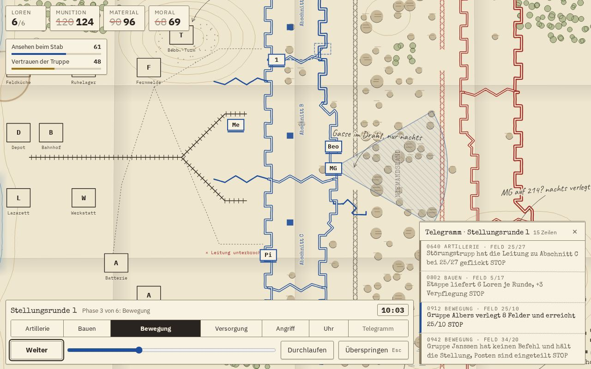

- **Weiter** (Enter, Leertaste) zeigt die nächste Phase, die Reiter oben springen direkt dorthin.
- **Durchlaufen** spielt alles ab, **Überspringen** (Esc) springt ans Ende.
- Am Ende wird es, wenn die Runde in die Nacht führt, dunkel. Das ist keine Optik: Nachts sieht man wirklich weniger.

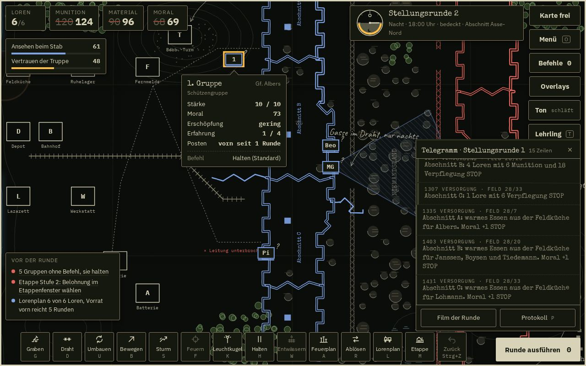

Im **Telegramm** steht jede Meldung mit Uhrzeit, Ort und Begründung („Längsfeuer, Graben ohne Traverse“). Ein Klick springt zur Stelle auf der Karte und im Film zum Zeitpunkt. **Protokoll** (P) zeigt alle Runden der Mission, jede alte Runde lässt sich als Film neu abspielen.

### Bleistift auf der Karte

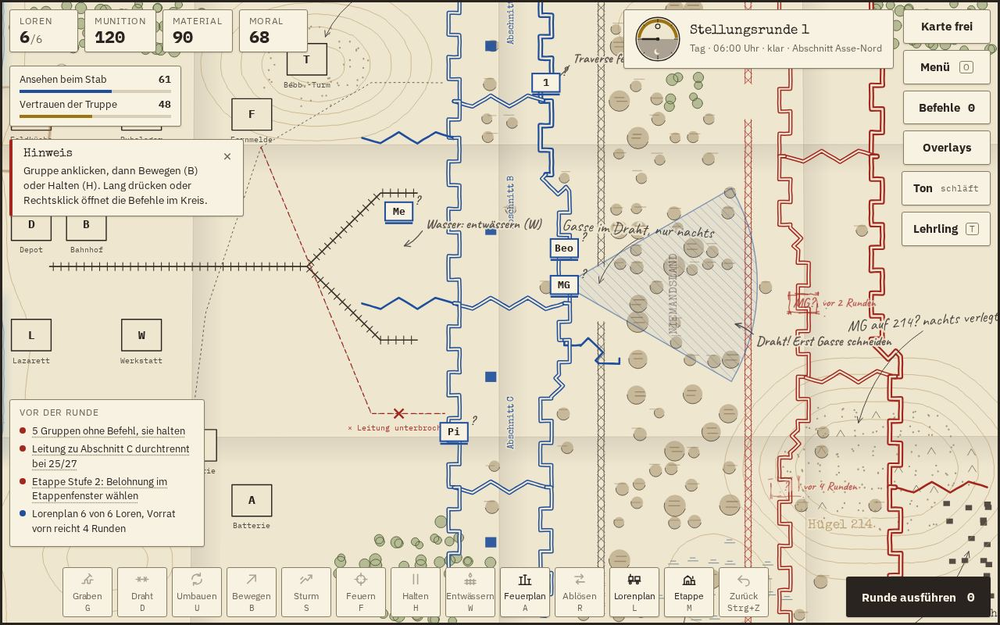

Geht etwas schief, das man beim nächsten Mal anders machen kann, schreibt jemand mit Bleistift an die Stelle, was gefehlt hat:

| Notiz | Bedeutet |
|---|---|
| Traverse fehlt! (Graben G) | Verluste durch Längsfeuer. Graben mit Traversen neu ziehen |
| erst umbauen (U) | Eroberter Graben zeigt noch zur falschen Seite |
| Draht! Erst Gasse schneiden | Sturm hängt im Draht. Pioniere vorn oder Artillerie zuerst |
| Wasser: entwässern (W) | Graben läuft voll. Lattenrost und Pumpe legen |
| Weg zu: Loren kommen nicht durch | Loren kommen nicht durch. Laufgraben oder Gleis ist unterbrochen |
| Lorenplan prüfen (L) | Ein Abschnitt hungert oder hat keine Munition |
| ohne Deckung: eingraben (G) | Granatfeuer trifft eine Gruppe im offenen Feld |
| eigene Walze zu dicht! | Die Feuerwalze trifft die eigenen Sturmgruppen |

Die Notizen bleiben für die ganze Mission auf dem Blatt.

## 6. Versorgung, Etappe, Ablösung

### Der Lorenplan

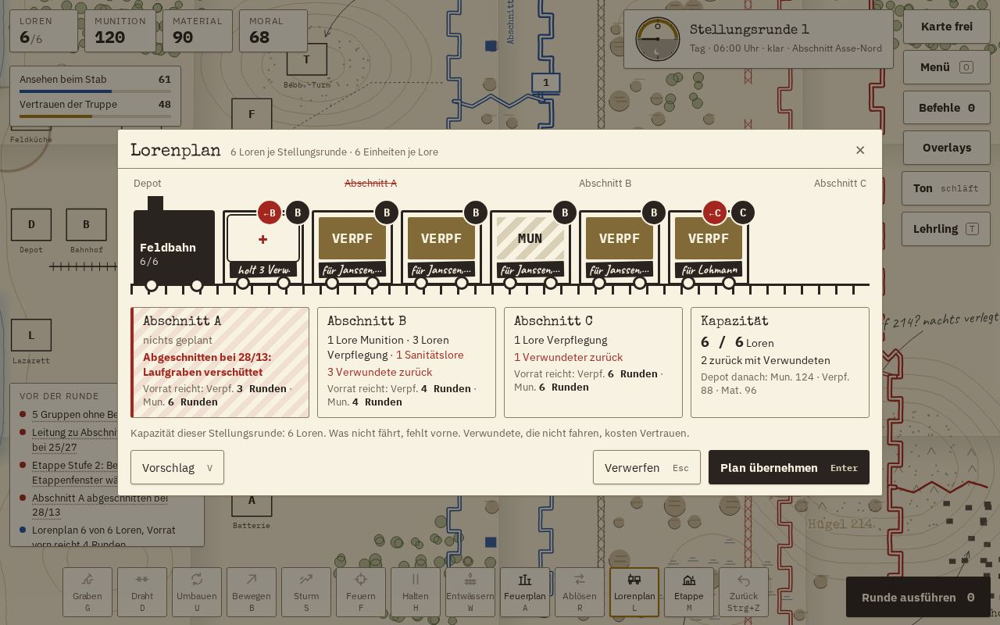

Alles kommt über die **Feldbahn** nach vorn. **Lorenplan** (L) zeigt den Zug der nächsten Runde:

- Tippe einen Wagen an, um die Ladung zu wechseln: Munition, Verpflegung, Material, **Sanitätslore** (holt Verwundete) oder frei.
- Der Kreis am Wagen wählt den Abschnitt (A, B, C).
- Unten steht je Abschnitt, was ankommt, wie lange der Vorrat reicht und wo der Weg unterbrochen ist.
- **Vorschlag** (V) füllt den Zug sinnvoll, **Plan übernehmen** (Enter) gilt ab jetzt jede Runde, bis du ihn änderst.

Verwundete fahren auf denselben Wagen zurück. Bleiben sie liegen, kostet das Vertrauen.

### Die Etappe

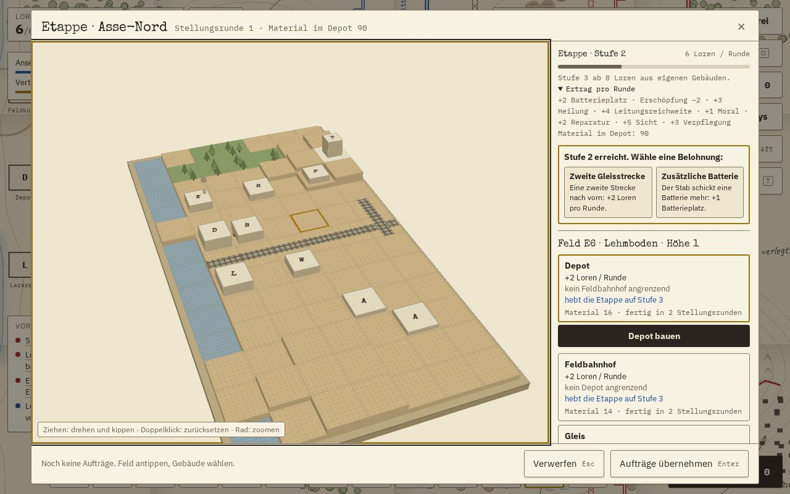

Das hintere Drittel deiner Karte ist die **Etappe**. **Etappe** (M) öffnet das drehbare Modell: links die Parzellen, rechts was dort gebaut werden kann, mit Ertrag und **Nachbarbonus** (zum Beispiel bringen Depot und Feldbahnhof nebeneinander mehr Loren). Gebäude kosten Material und Bauzeit in Stellungsrunden. Neu in dieser Ausgabe: eine fertige **Batteriestellung** bringt Geschütze, eine **Werkstatt** setzt zerschossene Gebäude von selbst instand.

### Ablösen

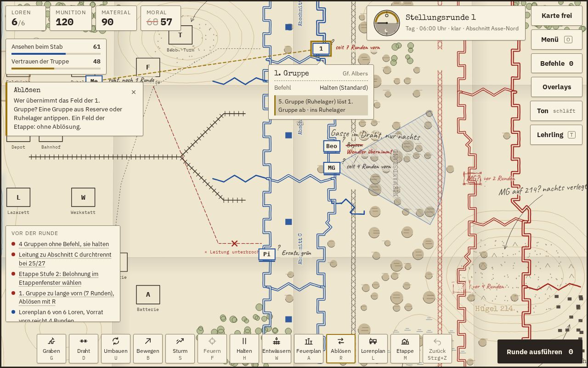

Gruppen vorn werden jede Runde müder. Ab sechs Runden vorn steht rot „zu lange vorn“, dann sinken Moral und Vertrauen. **Ablösen** (R): Gruppe vorn wählen und die Ablösung aus Reserve oder Ruhelager antippen. Die Gruppe hinten selbst antippen füllt sie mit Ersatz auf (grüner Ersatz senkt die Erfahrung).

## 7. Angreifen

Ein Angriff ist ein geplantes Ereignis, kein Klick. Die Reihenfolge:

1. **Aufklären.** Beobachter auf eine Höhe, sehen, wo drüben MG und Draht stehen (Overlay 2 Bedrohung).
2. **Feuerplan.** Ohne Artillerie läuft ein Sturm ins MG.
3. **Angriff ansetzen.** In der Stellungsrunde mit **Sturm** (S) den Weg festlegen.
4. **Gefechtsrunden.** Ab dann geht es in Fünf-Minuten-Schritten weiter.

### Feuerplan und Feuerwalze

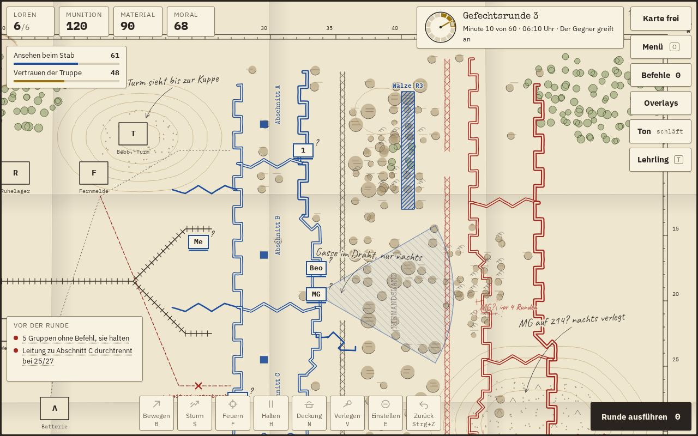

**Feuerplan** (A) öffnet den Editor im Blaupausen-Stil: Linie ziehen, Richtung und Schritt je Gefechtsrunde einstellen, die Walze erscheint als Zeitleiste über der Karte, die Sturmgruppen als Geister entlang ihres Weges. Planarten: **Vorbereitungsfeuer**, **Sperrfeuer** (zur Verteidigung), **Feuerwalze**, **Störfeuer**, **Gegenbatterie**. Im Gefecht kann nur ein **Beobachter mit intakter Leitung** das Feuer verlegen oder einstellen, mit einer Runde Verzögerung.

### Der Wettlauf zum Grabenrand

Unter Beschuss gehen Verteidiger in den **Unterstand**. Dort sind sie sicher, schießen aber nicht. Herauskommen dauert eine Gefechtsrunde. Hört die Walze zu früh auf, steht der Gegner am MG, bevor dein Sturm ankommt. Läuft sie zu dicht, trifft sie die eigenen Leute.

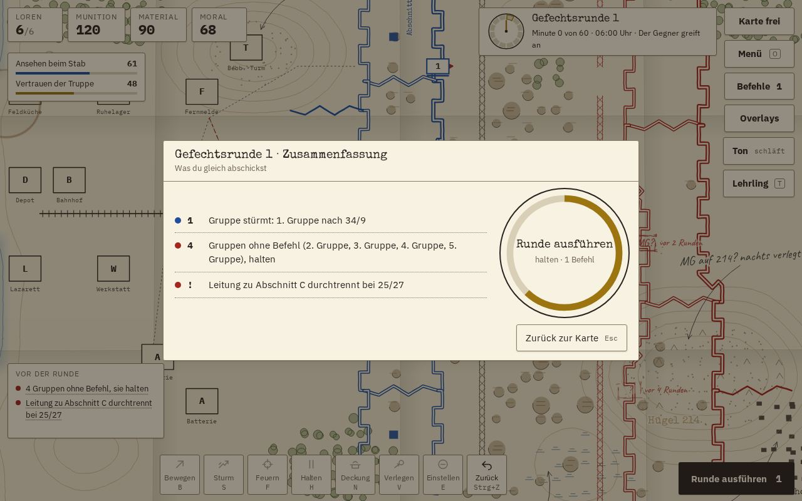

Ist ein Sturm geplant, muss **Runde ausführen** gehalten werden, bis der Ring voll ist. Das ist Absicht.

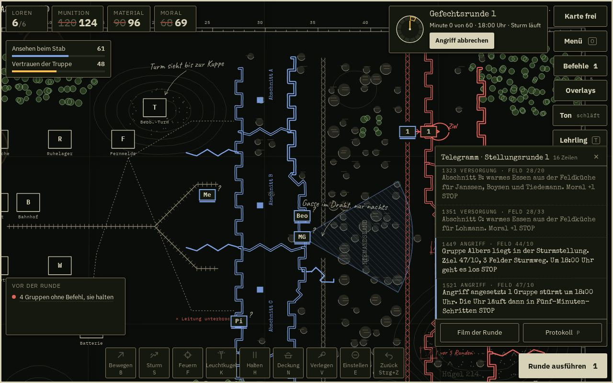

In der Gefechtsrunde wird die Tag-Nacht-Scheibe zur **Stoppuhr** mit zwölf Feldern zu fünf Minuten. Der Angriff endet, wenn das Ziel genommen ist, alle Sturmgruppen liegen bleiben oder nach einer Stunde. **Angriff abbrechen** steht im Rundenkärtchen. Ein eroberter Graben gibt nur halbe Deckung, bis er **umgebaut** (U) ist; der Verteidiger bekommt meist den Befehl zum Gegenstoß.

## 8. Tag, Nacht und Wetter

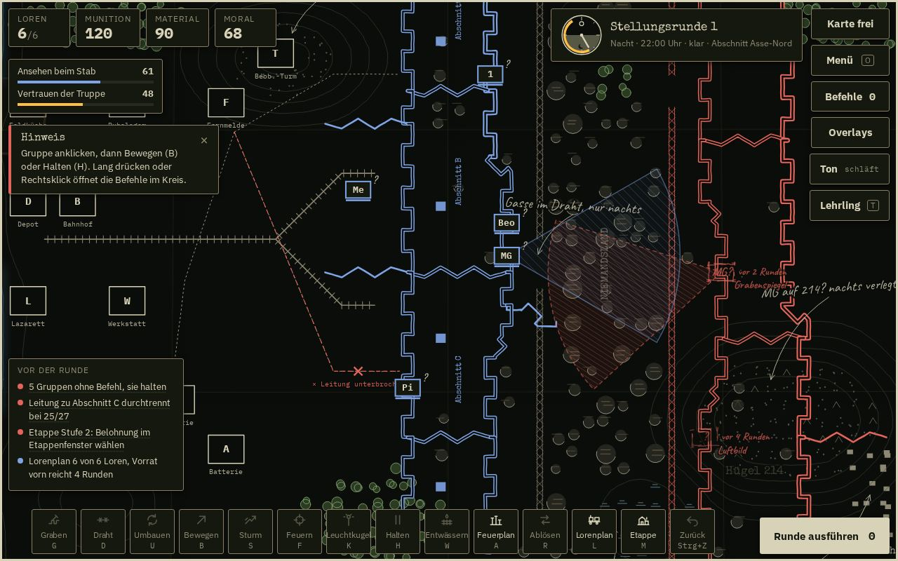

Stellungsrunden wechseln zwischen Tag und Nacht. Nachts sieht niemand weit; **Leuchtkugeln** (K) erhellen eine Runde lang einen Kreis und verraten jede Bewegung darin, auch deine. Posten schießen selbst, wenn sie etwas hören.

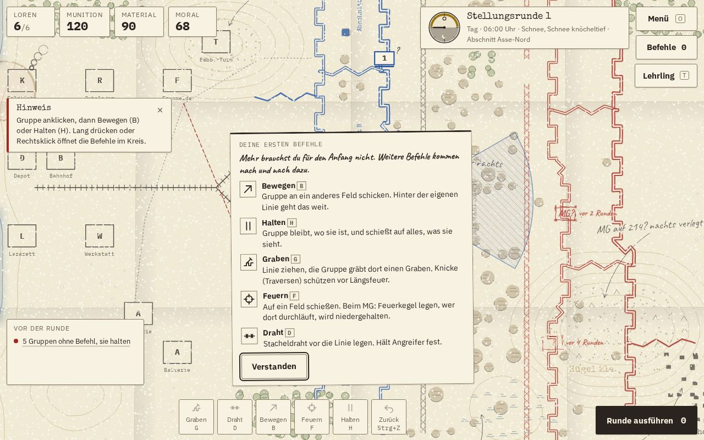

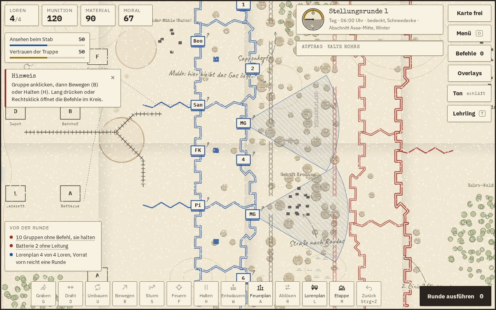

**Regen** macht den Lehm weich, Gräben laufen voll, zuerst in Senken; **Schlamm** kostet Bewegung, Grabtempo und Moral. Krater machen jedes Feld zu Schlamm: wer am meisten schießt, kommt am schlechtesten nach. Im Winter (Akt 3, Frontabschnitt, Werkstatt) liegt **Schnee**, und statt Regen schneit es: ab Knöcheltiefe dauern Wege länger, nachts frieren Posten ohne Unterstand, und Tauwetter macht alles zu Schlamm. **Nebel** schluckt fast alle Sicht.

## 9. Wenn du nicht weiterweißt

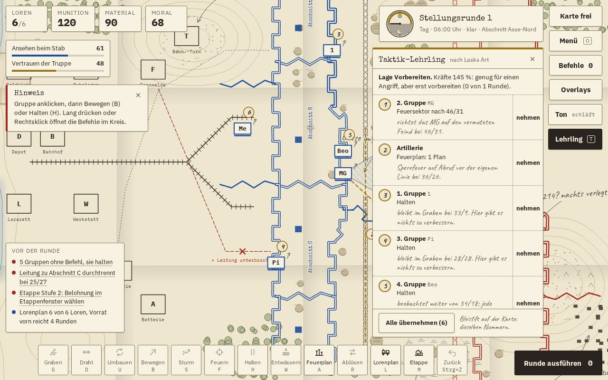

- **Lehrling** (T): Dieselbe KI wie drüben rechnet, was sie an deiner Stelle täte, mit nummerierten Vorschlägen und Begründung in Handschrift. Einzeln **nehmen** oder **Alle übernehmen**; eigene Befehle werden nicht überschrieben.
- **Vor der Runde**: Was dort rot steht, ist ein Hinweis, keine Pflicht.
- **Handbuch**: alle Begriffe von A bis Z.

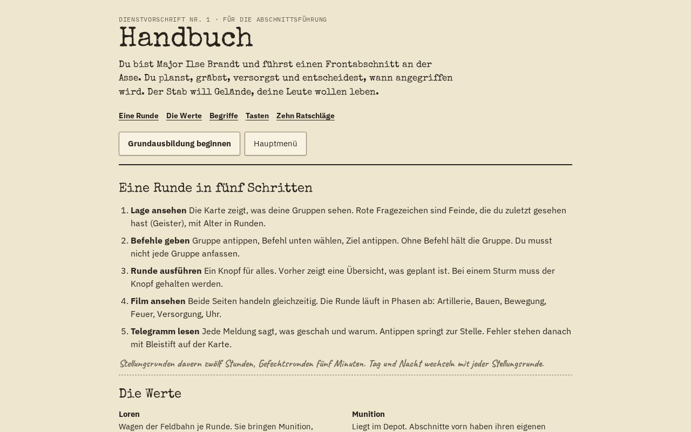

## 10. Wie es weitergeht

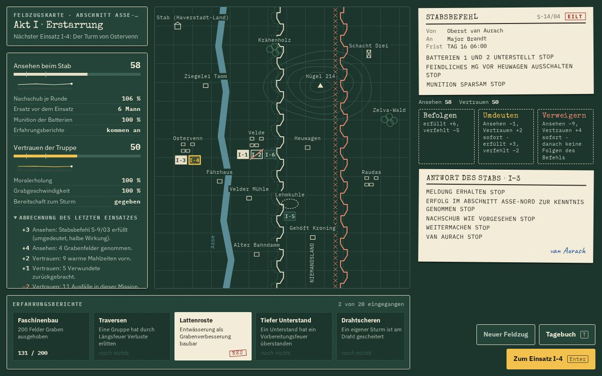

Die **Kampagne** führt in vier Akten zu je sechs Missionen durch den Krieg. Zwischen den Missionen liegen Briefe, Zeitungen, das Tagebuch und die Gefallenenliste auf dem Tisch. Stabsbefehle kannst du **befolgen**, **umdeuten** oder **verweigern**; jede Wahl bewegt Ansehen und Vertrauen, und aus beiden ergibt sich am Ende eines von vier Enden.

| Modus | Für wen |
|---|---|
| Kampagne | Geschichte, Akt 1 erklärt jede Mechanik einzeln |
| Gefecht frei | eine Partie auf vier Karten oder einer Zufallskarte |
| Tageslage | jeden Tag eine Woche für alle gleich, mit Wachbuch |
| Frontabschnitt | Endlos: Woche um Woche, Jahreszeiten, dieselben Leute |
| Hotseat | zwei an einem Gerät, Übergabe im versiegelten Umschlag (mit Bleistiftzeile für drüben) |
| Koop | zwei gegen die KI an einem Gerät |
| Fernsprechamt | online gegen Freunde per Einladungscode |
| Lehrgang | zwölf Puzzle-Lagen mit fester Lösung |
| Werkstatt | Sandkasten für Stellungen und Missionseditor |

## 11. Bedienung auf Handy und Tablet

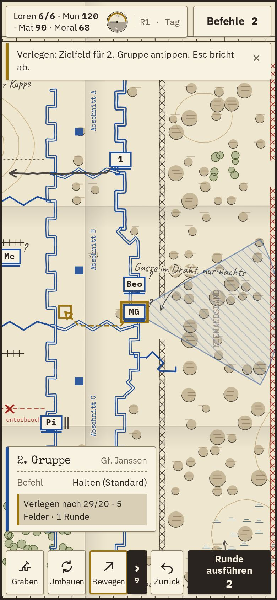
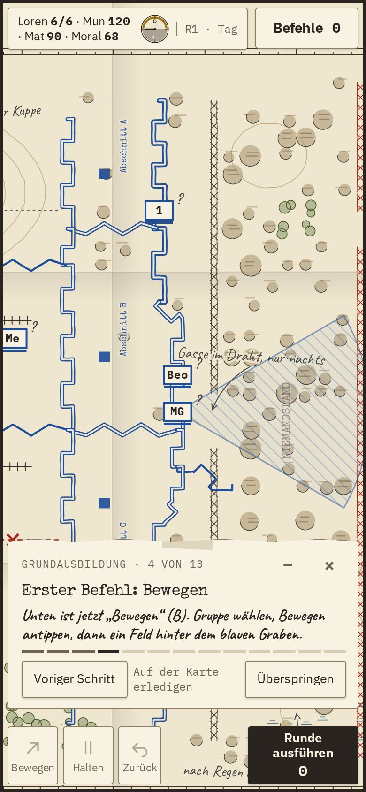

- Die Werte oben stecken in einer Leiste; antippen klappt die Seitenleiste mit allen Kärtchen auf.
- Die Werkzeugreihe zeigt zuerst die Befehle, die gerade gehen. Die Lasche **›** mit Zahl zeigt die übrigen.
- **Ziel antippen**: erst vormerken (Bleistift), dann noch einmal antippen. Im Dienstbuch unter Darstellung auf „sofort setzen“ umstellbar.
- **Lang drücken** auf eine Gruppe öffnet den Befehlskreis.
- **Leeres Feld antippen** mit gewählter Gruppe zeigt die Sichtlinie, ein zweites Antippen hebt die Auswahl auf.
- Zwei Finger schieben und zoomen die Karte.

## 12. Tasten

| Taste | Wirkung |
|---|---|
| G, D, U, B, S, F, H, W, A, R, L, M | Graben, Draht, Umbauen, Bewegen, Sturm, Feuern, Halten, Entwässern, Feuerplan, Ablösen, Lorenplan, Etappe |
| K | Leuchtkugel (nachts) |
| Leertaste | nächste Gruppe ohne Befehl |
| Enter | Runde ausführen (Zusammenfassung) |
| Tab | Befehlsliste |
| 1 bis 4 | Overlays: Versorgung, Bedrohung, Sicht, Höhe |
| T | Taktik-Lehrling |
| P | Protokoll der Mission |
| O | Dienstbuch (Speichern, Klang, Darstellung) |
| ^ | Karte frei |
| Strg+Z | letzten Befehl zurücknehmen |
| Esc | schließen, abbrechen |
| Pfeile, Mausrad, Ziehen | Karte bewegen und zoomen |

Gesperrte Befehle reagieren nicht auf ihre Taste. Die vollständige Liste mit allen Befehlen späterer Akte steht im Handbuch und im Dienstbuch (Reiter Tasten).

## 13. Häufige Fragen

**Wo sind die anderen Befehle?** Am Anfang gibt es nur wenige. Weitere kommen mit der Grundausbildung und Akt 1 dazu (siehe Abschnitt 2). Alle sofort: Dienstbuch, Darstellung, „Befehle im Gefecht“.

**Muss ich jeder Gruppe einen Befehl geben?** Nein. Ohne Befehl hält die Gruppe und schießt auf alles, was sie sieht.

**Warum ist mein Angriff gescheitert?** Lies das Telegramm und die Bleistiftnotizen. Meist fehlte Artillerie, der Draht war nicht geschnitten oder die Walze lag falsch.

**Warum sehe ich die Feinde nicht?** Du siehst nur, was deine Gruppen sehen (Nebel des Krieges). Beobachter auf Höhen und Leuchtkugeln bei Nacht helfen; rote Fragezeichen sind Feinde, die du zuletzt gesehen hast.

**Wie speichere ich?** Die laufende Akte speichert sich nach jeder Runde selbst. Im Dienstbuch (O) gibt es drei Kartentaschen und eine Sicherung als Datei.

**Ist das Ergebnis Zufall?** Es gibt Würfe, aber alles ist nachvollziehbar: gleicher Seed und gleiche Befehle ergeben denselben Verlauf. Jede Zeile im Telegramm sagt, warum etwas geschah.

**Kann ich die Grundausbildung wiederholen?** Ja, jederzeit über das Hauptmenü oder das Handbuch.

---

Die Bilder in dieser Anleitung entstehen mit `node tools/tutorial-shots.mjs` aus den Demo-Zuständen des Spiels und lassen sich nach Änderungen neu erzeugen.
